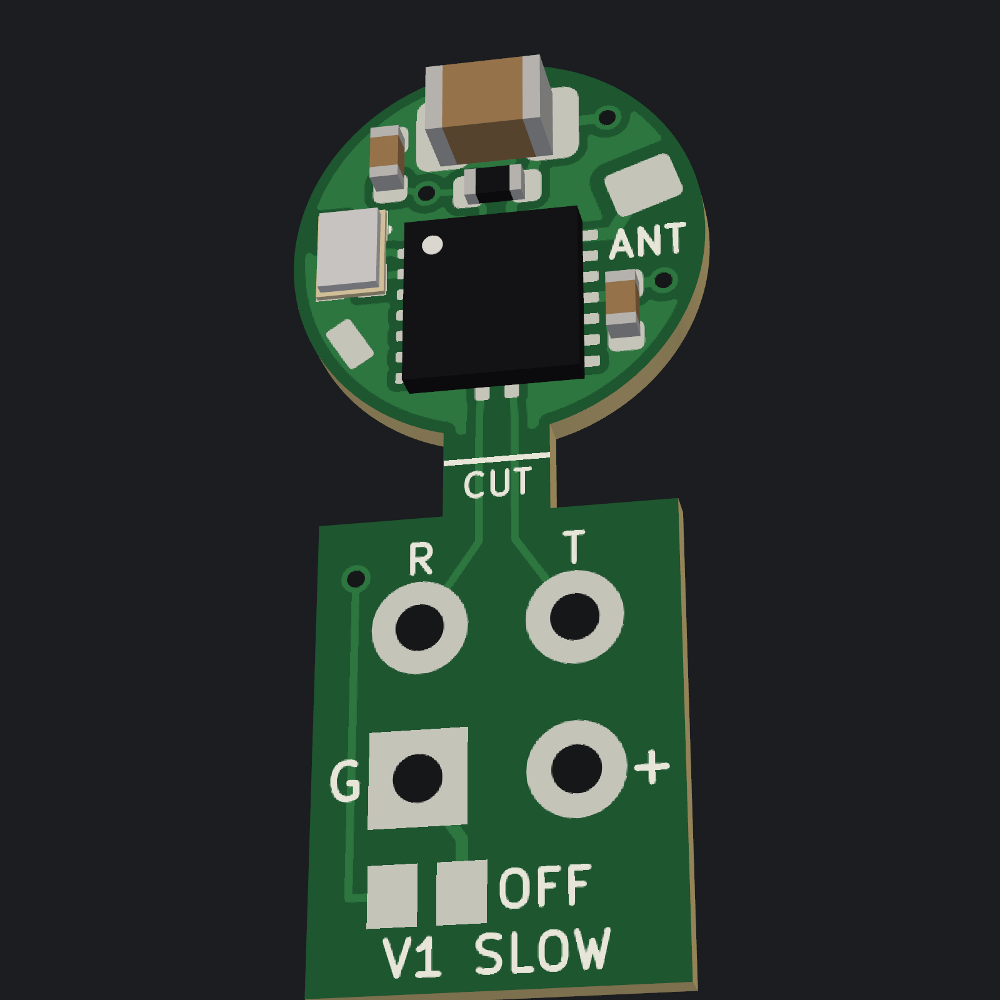
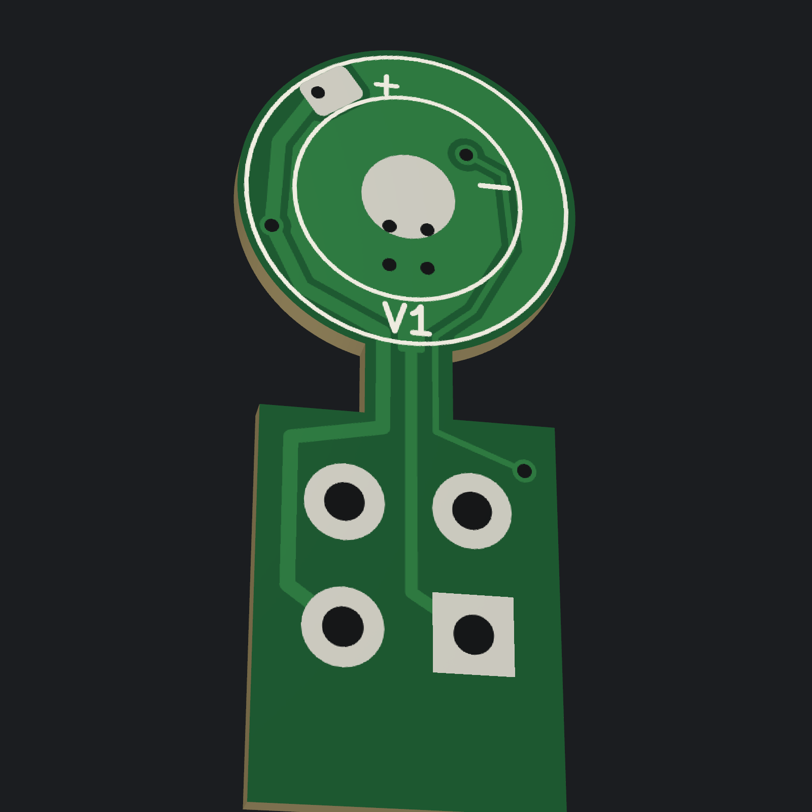

<h1 align="center">gantu-tag · ಗಂಟು</h1>

<b>Open, tiny Bluetooth LE tracking tags for insects that anyone can order from JLCPCB.</b>

*Gantu* (ಗಂಟು, said *gun-two*) is Kannada for a knot: a tag is something you tie onto an animal.
[More about the name](#about-the-name).

**Website:** https://pvnkmrksk.github.io/gantu-tag/

These are **early pilots**. The first panels were ordered on 6 November 2026 and arrived assembled on 19 November;
bench testing starts now. Treat every number here as a design estimate until the bring-up results are in.

## The two tags

 

| | **Hagalu Gantu** · ಹಗಲು ಗಂಟು | **Irulu Gantu** · ಇರುಳು ಗಂಟು |
|---|---|---|
| Power | Six photodiodes charge a 100 µF capacitor; no battery | A silver-oxide button cell (337, 364 or 377) |
| When it runs | **In light only**, in bursts as the capacitor fills | Continuously until the cell is flat (≈ 57 days on a 337 at a 3 s interval) |
| Size (after cutting the tail) | 6.4 × 12.55 mm | Ø 7.2 mm |
| Mass (design estimate, 0.6 mm board) | ≈ 0.19–0.21 g | ≈ 0.12 g without the cell, ≈ 0.25 g with a 337 |
| Start-up | On S6/S6L a supervisor starts the radio once the capacitor holds a burst; N6 has none | Fit the cell (V1), or cut the tail (V2) |
| Pilot variants on the panel | S6, S6L, N6 | V1, V2 |
| Design files | [`hagalu/`](hagalu/) | [`irulu/`](irulu/) |

### Renders

KiCad 10 renders of the v8.3 boards as ordered. Top: parts side. Bottom: the antenna pads on Hagalu, and the cell
pads on Irulu.

| | Top | Bottom |
|---|---|---|
| **Hagalu Gantu** |  |  |
| **Irulu Gantu** |  |  |

The JLC panel (94.9 × 71.1 mm, 0.6 mm), with 10 Hagalu and 8 Irulu tags on each panel:

Both use the InPlay **IN100 NanoBeacon**, a beacon chip configured rather than programmed. One tag works on Apple
**Find My** (OpenHaystack-style static key) or on **Hubble**, chosen when you burn its one-time-programmable memory.
You don't change the hardware to switch networks.

The pilot variant names (S6, S6L, N6, V1, V2) only mark the start-circuit options under test. They'll be narrowed
down once the first tags are on the bench.

## Build your own

1. **Order:** upload the files in [`order/`](order/). That folder holds the exact zip sent to JLCPCB, with the order
   settings and the placement checks. One order gives two assembled panels: 20 Hagalu and 16 Irulu tags.
2. **Program:** four wires from a 3.3 V USB-serial adapter to the tail, and InPlay's NanoBeacon Config Tool. See
   [`docs/programming.md`](docs/programming.md).
3. **Finish:** break the tag out, fit the antenna wire (and the cell on Irulu), cut the tail and coat it in epoxy.
   The step-by-step for each tag is in [`hagalu/README.md`](hagalu/README.md) and [`irulu/README.md`](irulu/README.md).

## Repository map

| Folder | What's in it |
|---|---|
| [`hagalu/`](hagalu/) | Solar tag: KiCad project, the Python that generates it (`tools/design.py`), solar simulation, renders, review |
| [`irulu/`](irulu/) | Battery tag: KiCad project, generator, burst simulation, renders, review |
| [`panel/`](panel/) | The combined 0.6 mm JLC panel (KiKit layout, mixed-variant BOM/CPL) and its ordering README |
| [`order/`](order/) | The exact files sent to JLCPCB, with a checksum |
| [`docs/`](docs/) | Programming guide, the v8 handover and build notes, the logo |

## History

Every revision is a commit, dated when it was made. The commit that closes each version:

| Version | What changed |
|---|---|
| [`v4`](https://github.com/pvnkmrksk/gantu-tag/tree/ffad947) | 6.4 mm round tag on a 0.6 mm board, printed antenna arm, cut-off programming tab |
| [`v5`](https://github.com/pvnkmrksk/gantu-tag/tree/3f6ccb6) | 8 mm tag with a 30 mm wire antenna; all parts on the top side, cell underneath |
| [`v6`](https://github.com/pvnkmrksk/gantu-tag/tree/cb1977e) | 7 mm tag with a Blu Bat-style **cut-to-start tail** (superseded: pour and decoupling faults, don't order) |
| [`v7`](https://github.com/pvnkmrksk/gantu-tag/tree/bdc53f7) | Fixes v6; any button cell; five population variants on one test panel |
| [`v8.3`](https://github.com/pvnkmrksk/gantu-tag/tree/761deb4) | Split into **Hagalu** (solar) and **Irulu** (battery) on one combined 0.6 mm panel. **This is what was ordered** |

Before v8 there was only the battery tag, so its history lives in `irulu/`. Click a version to browse it, or
`git checkout cb1977e` for v6, for example.

## Bill of materials and cost

Per-tag parts lists with LCSC numbers are on the [website](https://pvnkmrksk.github.io/gantu-tag/#bom); the full
panel BOM is [`panel/fab/jlcpcb_panel/insect_tag_v8_combined_panel_bom.csv`](panel/fab/jlcpcb_panel/insect_tag_v8_combined_panel_bom.csv).
The first order (5 bare panels, 2 assembled, 36 tags) came to roughly **€250–280 before shipping and VAT, about €7 per
assembled tag**. Parts are about three quarters of that: about €6 per Hagalu and €2.30 per Irulu, mostly the IN100 and
the photodiodes. Prices are from November 2026; the JLC cart is the real number.

## Licence

Hardware designs and documentation: [CC BY-SA 4.0](LICENSE). The designs reference InPlay's IN100 datasheet and
SparkFun's NanoBeacon boards (CC BY-SA 4.0). No warranty: you build and use these at your own risk.

Designed by Pavan Kumar Kaushik (Max Planck Institute of Animal Behaviour, Konstanz).

## About the name

| Name | Kannada | Say it | IPA | Meaning |
|---|---|---|---|---|
| Gantu | ಗಂಟು | *gun-two* | /ɡəɳʈu/ | A knot; also a small bundle tied up to carry |
| Hagalu | ಹಗಲು | *huh-guh-loo* | /ɦəɡəlu/ | Daytime |
| Irulu | ಇರುಳು | *ih-roo-loo* | /iruɭu/ | Night |

The *ṇṭ* in gantu is retroflex (tongue curled back), and the *ḷ* in irulu is a retroflex *l*. Hagalu runs only when
there's light; Irulu keeps going through the night. The logo is one thread tied in a trefoil knot, shading from
turmeric ochre into indigo.
