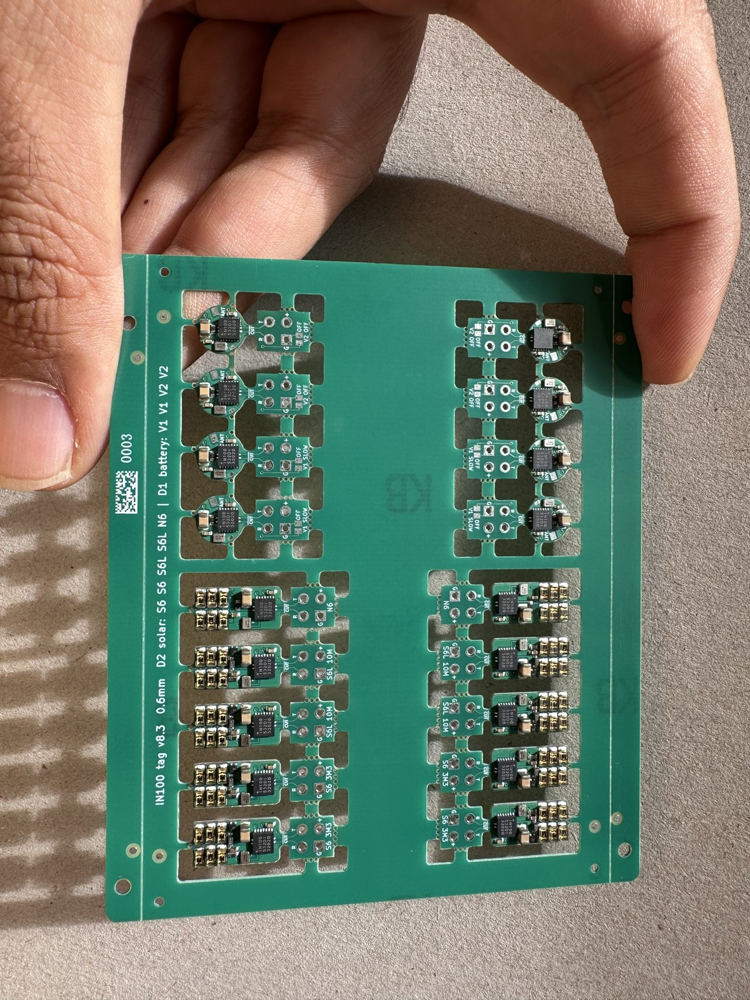
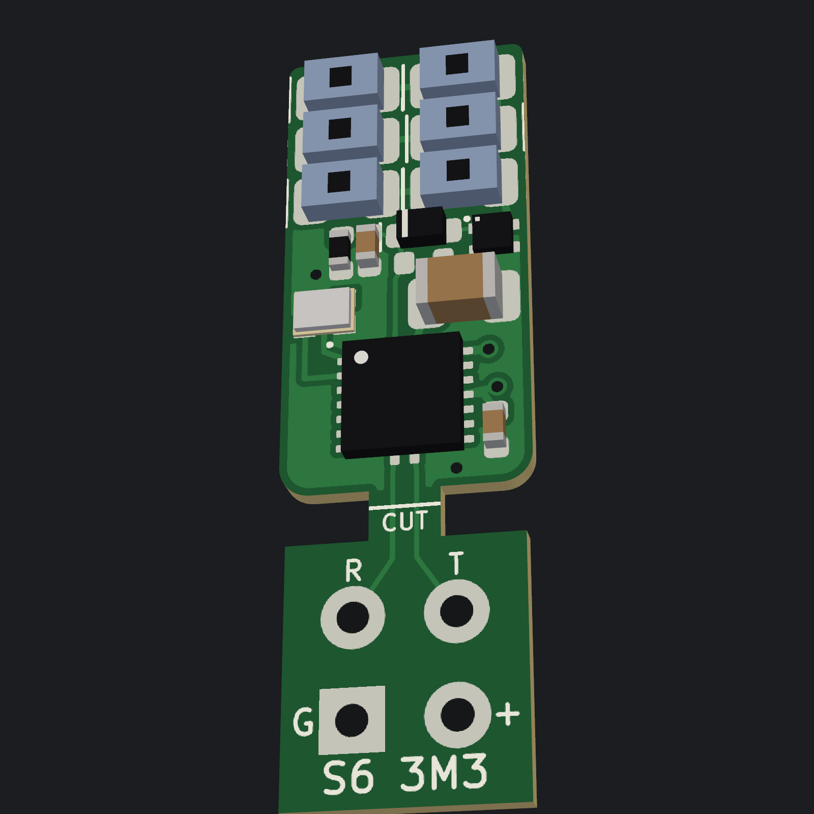
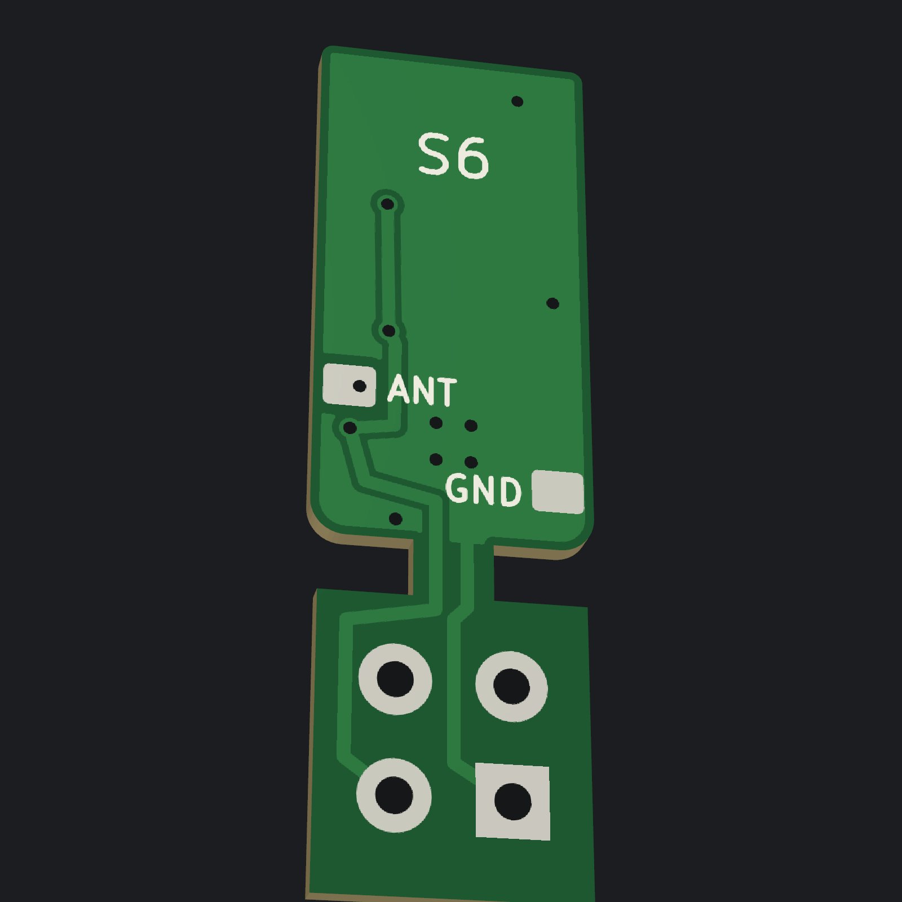
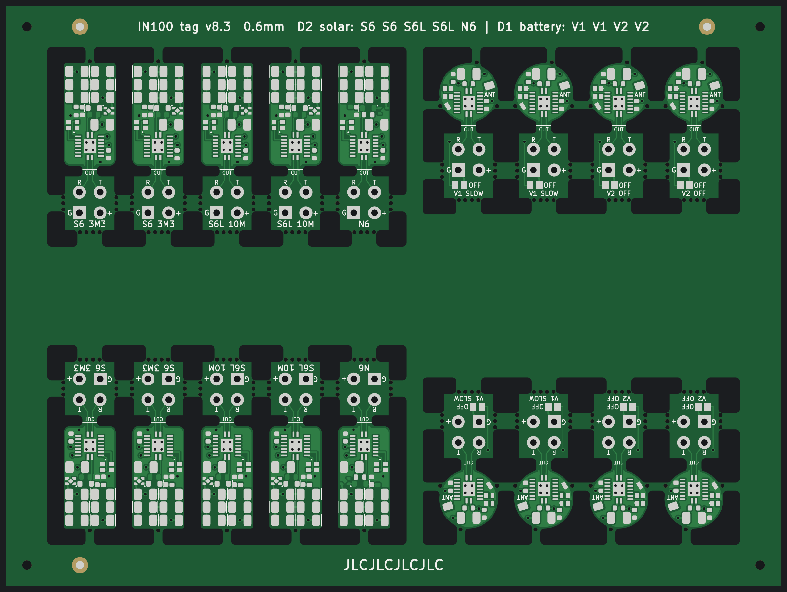

<h1 align="center">gantu-tag · ಗಂಟು</h1>

<b>Open, tiny Bluetooth LE tracking tags for insects that anyone can order from JLCPCB.</b>

*Gantu* (ಗಂಟು, said *gun-two*) is Kannada for a knot, for someone who clings on and goes wherever you go, and for
a node.
[More about the name](#about-the-name).

**Website:** https://pvnkmrksk.github.io/gantu-tag/

These are **early pilots**. The first panels were ordered on 6 November 2026 and arrived assembled on 19 November;
bench testing has started. **First result, the same evening:** a Hagalu S6, configured over UART and run from RAM
with a plain copper antenna, was picked up by passing iPhones and reported through Apple Find My three times in
20 minutes (±76–102 m). It advertised steadily from about 1.9 klx, and weighs **0.242 g** with its wire antenna
(tail cut, no epoxy). Treat every other number here as a design estimate until bring-up is complete.

| Weighed: 0.242 g | Advertising Find My under 1.7 klx |
|---|---|
|  |  |

## The two tags

 

| | **Hagalu Gantu** · ಹಗಲು ಗಂಟು | **Irulu Gantu** · ಇರುಳು ಗಂಟು |
|---|---|---|
| Power | Six photodiodes charge a 100 µF capacitor; no battery | A silver-oxide button cell (337, 364 or 377) |
| When it runs | **In light only**, in bursts as the capacitor fills | Continuously until the cell is flat (≈ 57 days on a 337 at a 3 s interval) |
| Size (after cutting the tail) | 6.4 × 12.55 mm | Ø 7.2 mm |
| Mass (0.6 mm board) | **0.242 g measured** (S6 with wire, no epoxy; estimate was 0.19–0.21 g) | ≈ 0.12 g without the cell, ≈ 0.25 g with a 337 (estimate) |
| **Cost per tag** (approx.) | **≈ €7** | **≈ €2.30** + a button cell |
| Start-up | On S6/S6L a supervisor starts the radio once the capacitor holds a burst; N6 has none | Fit the cell (V1), or cut the tail (V2) |
| Pilot variants on the panel | S6, S6L, N6 | V1, V2 |
| Design files | [`hagalu/`](hagalu/) | [`irulu/`](irulu/) |

### Renders

KiCad 10 renders of the v8.3 boards as ordered. Top: parts side. Bottom: the antenna pads on Hagalu, and the cell
pads on Irulu.

| | Top | Bottom |
|---|---|---|
| **Hagalu Gantu** |  |  |
| **Irulu Gantu** |  |  |

The JLC panel (94.9 × 71.1 mm, 0.6 mm), with 10 Hagalu and 8 Irulu tags on each panel:

The pilot variant names (S6, S6L, N6, V1, V2) only mark the start-circuit options under test. They'll be narrowed
down once the first tags are on the bench.

## Approach

The tag doesn't carry a GPS or a receiver. It only **broadcasts a Bluetooth LE advert every few seconds**, and phones
or gateways that belong to a large existing network hear it and report where they were. You then fetch those
reports.

- **One chip, configured rather than programmed.** Both tags use the InPlay
  [IN100 NanoBeacon](https://inplay-tech.com/in100). It runs no firmware: you load a configuration over its UART
  (address, advert bytes, interval, TX power), test it in RAM, then burn it once into the chip's one-time-programmable
  memory. That keeps the tag down to the chip, a crystal and a few capacitors.
- **Two networks, the same hardware.** Which network a tag joins is decided only by what you burn into it:
  - **Apple Find My** via [OpenHaystack](https://github.com/seemoo-lab/openhaystack): the tag sends a fixed-key
    Find My advert, nearby iPhones relay its position to Apple, and you decrypt the reports with your private key.
    No Apple hardware is needed on the tag side, and it costs nothing per tag.
  - **[Hubble Network](https://hubble.com)**: the IN100 is one of Hubble's supported chips, and its adverts are picked
    up by Hubble's terrestrial network of phones and gateways and, as its next satellites arrive, from orbit. Hubble
    is a paid service with a free starter tier.
- **Built by JLCPCB, finished by hand.** Every part is placed by JLCPCB's assembly service from its own stock, on a
  2-layer 0.6 mm board. You add only the antenna wire, the cell (Irulu) and epoxy.
- **Started by cutting.** Each tag carries its programming pads on a tail. Like commercial bat and insect tags, you
  program it, then cut the tail off; on Irulu V2 the cut is also what switches it on.
- **Pilots before a batch.** The first panel carries several population variants of each tag (S6/S6L/N6 and V1/V2),
  so one order shows which start circuit works before anyone orders in bulk.

## Build your own

1. **Order:** upload the files in [`order/`](order/). That folder holds the exact zip sent to JLCPCB, with the order
   settings and the placement checks. One order gives two assembled panels: 20 Hagalu and 16 Irulu tags.
2. **Program:** four wires from a 3.3 V USB-serial adapter to the tail, and InPlay's NanoBeacon Config Tool. See
   [`docs/programming.md`](docs/programming.md).
3. **Finish:** break the tag out, fit the antenna wire (and the cell on Irulu), cut the tail and coat it in epoxy.
   The step-by-step for each tag is in [`hagalu/README.md`](hagalu/README.md) and [`irulu/README.md`](irulu/README.md).

## Roadmap

Lighter first, then simpler, then cheaper. The full plan, with mass targets, is in [`docs/roadmap.md`](docs/roadmap.md).

| Stage | What | Hagalu | Irulu (with a 337) |
|---|---|---|---|
| **Now** | Bench work on the v8.3 pilots: mass split, Irulu bring-up, S6L/N6, a smaller C1, range, Hubble | 0.242 g measured | ≈ 0.25 g |
| **v9** | Polyimide flex, antenna as a trace on a flex tail, thinner copper, 47 µF C1 if it tests well | ≈ 0.13–0.16 g | ≈ 0.19–0.20 g |
| **v10** | IN100 in WLCSP (1.1 × 2.0 mm), 0201 parts; Irulu no bigger than its cell | ≈ 0.05–0.07 g | ≈ 0.16–0.17 g |

On Irulu the 0.13 g cell is the floor; everything else can shrink to ≈ 0.03–0.04 g.

## Repository map

| Folder | What's in it |
|---|---|
| [`hagalu/`](hagalu/) | Solar tag: KiCad project, the Python that generates it (`tools/design.py`), solar simulation, renders, review |
| [`irulu/`](irulu/) | Battery tag: KiCad project, generator, burst simulation, renders, review |
| [`panel/`](panel/) | The combined 0.6 mm JLC panel (KiKit layout, mixed-variant BOM/CPL) and its ordering README |
| [`order/`](order/) | The exact files sent to JLCPCB, with a checksum |
| [`docs/`](docs/) | Roadmap, programming guide, the v8 handover and build notes, bench photos, the logo |

## History

Every revision is a commit, dated when it was made. The commit that closes each version:

| Version | What changed |
|---|---|
| [`v4`](https://github.com/pvnkmrksk/gantu-tag/tree/ffad947) | 6.4 mm round tag on a 0.6 mm board, printed antenna arm, cut-off programming tab |
| [`v5`](https://github.com/pvnkmrksk/gantu-tag/tree/3f6ccb6) | 8 mm tag with a 30 mm wire antenna; all parts on the top side, cell underneath |
| [`v6`](https://github.com/pvnkmrksk/gantu-tag/tree/cb1977e) | 7 mm tag with a Blu Bat-style **cut-to-start tail** (superseded: pour and decoupling faults, don't order) |
| [`v7`](https://github.com/pvnkmrksk/gantu-tag/tree/bdc53f7) | Fixes v6; any button cell; five population variants on one test panel |
| [`v8.3`](https://github.com/pvnkmrksk/gantu-tag/tree/761deb4) | Split into **Hagalu** (solar) and **Irulu** (battery) on one combined 0.6 mm panel. **This is what was ordered** |

Before v8 there was only the battery tag, so its history lives in `irulu/`. Click a version to browse it, or
`git checkout cb1977e` for v6, for example.

## Bill of materials and cost

Per-tag parts lists with LCSC numbers are on the [website](https://pvnkmrksk.github.io/gantu-tag/#bom); the full
panel BOM is [`panel/fab/jlcpcb_panel/insect_tag_v8_combined_panel_bom.csv`](panel/fab/jlcpcb_panel/insect_tag_v8_combined_panel_bom.csv).
Approximate cost per tag, parts and JLC placement, at November 2026 prices:

| | Per tag |
|---|---|
| **Hagalu Gantu** (solar) | **≈ €7** |
| **Irulu Gantu** (button cell) | **≈ €2.30**, plus the cell you fit yourself |

Each order also carries one-off fees of roughly €100 (setup, stencil, extended-part fees, bare boards), which you
spread over however many tags you order. The first order (5 bare panels, 2 assembled, 36 tags) came to about
**€250–280 before shipping and VAT**. Most of the cost is the IN100 (≈ $2.60) and, on Hagalu, the six photodiodes
(≈ $0.87 each). The JLC cart is the real number.

## Licence

Permissive, with attribution:

- **Hardware designs, documentation, renders and the logo:** [CC BY 4.0](LICENSE).
- **Scripts** (the Python and shell in `*/tools/`, `docs/logo/make_logo.py`) **and the website:** [MIT](LICENSE-CODE).

You can use, change, sell and build on all of it, commercially or not, as long as you credit the source. A line
like this is enough:

> Based on gantu-tag by Pavan Kumar Kaushik, https://github.com/pvnkmrksk/gantu-tag (CC BY 4.0)

The circuits follow InPlay's IN100 datasheet and the component values on SparkFun's NanoBeacon board; no SparkFun
design files are included. The archived JLC order zip in `order/` predates this licence and still says CC BY-SA 4.0
inside; the licence here applies to it. There's no warranty: you build and use these at your own risk.

## About the name

**Gantu** (ಗಂಟು, *gun-two*, /ɡəɳʈu/) works on three levels:

- **A knot.** The tag is tied onto the animal.
- **Clinging on.** Colloquially, someone who is *gantu* to you sticks to you and goes wherever you go, as if the two of
  you were knotted together. That's the tag and its insect.
- **A node,** as on a plant stem or in a network. The tag is found as a node heard by a mesh of phones and gateways.

**Hagalu** (ಹಗಲು, *huh-guh-loo*, /ɦəɡəlu/, day) and **Irulu** (ಇರುಳು, *ih-roo-loo*, /iruɭu/, night) name how each
tag works: Hagalu runs on daylight, Irulu runs on its cell through the night as well.

The *ṇṭ* in gantu is retroflex (tongue curled back), as is the *ḷ* in irulu. The logo is one thread tied in a trefoil
knot, shading from turmeric ochre into indigo.
