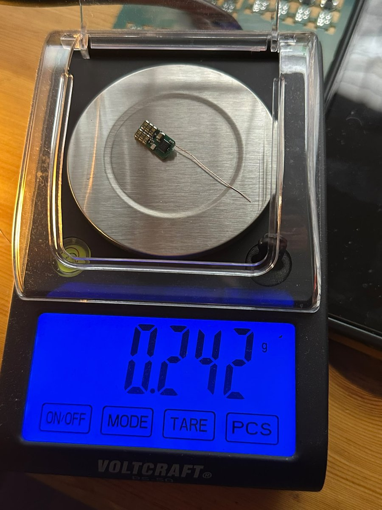

# Roadmap

Where gantu-tag goes after the v8.3 pilots. Written 19 November 2026, the day the first panels arrived. The order of
priority is **lighter, then simpler, then cheaper**: cost is already low, while mass decides which insects can carry a
tag.

## Where we are (19 Nov 2026)

First bench results from one Hagalu S6, run from RAM with a plain copper wire antenna:

| | Result | Design estimate |
|---|---|---|
| Find My | Picked up by passing iPhones and reported 3× in 20 min (±76–102 m) | — |
| Light for steady adverts at 3 s | **≈ 1.9 klx** (phone lux meter, desk lamp); patchy at ≈ 1.5 klx | ≈ 4.5 klx in daylight |
| Mass, tail cut, with ≈ 30 mm wire, no epoxy | **0.242 g** (Voltcraft, 1 mg resolution) | 0.19–0.21 g |
| RSSI on the bench | ≈ −40 to −57 dBm with the tag a few cm from the phone | — |

| Weighed | Advertising under 1.7 klx (nRF Connect, Find My payload) |
|---|---|
|  |  |

Two things to resolve from this:

- **It runs in less light than simulated.** Either the photodiodes give more than the datasheet suggests, the
  supervisor's window is wider, or the phone lux meter reads high. A photodiode's short-circuit current under the
  same lamp settles it.
- **It is ≈ 35–50 mg heavier than estimated.** Weighing a bare board from the panel splits that between the board and
  the parts.

## Stage 0: bench work on the v8.3 boards (now)

Nothing new to order. Each item answers a question that the next revision depends on.

- [ ] **Mass split:** weigh a bare Hagalu and a bare Irulu body (tail cut), an assembled one, then with antenna, cell
      and epoxy. This turns the estimates in the READMEs into measurements.
- [ ] **Irulu bring-up:** V1 first (SparkFun values), then V2 with the CHIP_EN load test. Weigh it with a 337.
- [ ] **Hagalu variants:** S6L and N6. N6 has no supervisor; if it starts cleanly, the start circuit can lose two parts.
- [ ] **Voltage- or current-limited in dim light?** Watch VCC across C1 at ≈ 1.5 klx. Stuck just below the 1.69 V
      start level means voltage (more or better cells); rising past it and draining means current (bigger cells or
      smaller bursts).
- [ ] **Smaller C1:** hand-swap C1 on two S6 and two Irulu tags to 47 µF 0603. If they still complete every advert
      (one-channel advertising if needed), v9 saves ≈ 13 mg per tag and Irulu can shrink.
- [ ] **Range, not RSSI:** walk-away test in the open with the tag at insect height, 0 dBm and +5 dBm. Also the time
      from first light to the first Find My report.
- [ ] **Coating:** light threshold and mass before and after epoxy over the photodiodes.
- [ ] **Antenna:** single wire vs dipole (AE1 + AE2) on range.
- [ ] **Hubble:** running from RAM on Hagalu-002 since 20 Nov 2026, with VCC, temperature and advert count in the
      encrypted payload, and seen in the Hubble app ([programming](programming.md#network-payloads)). Restarts
      decode fine on the bench (the counter starts again at period 0). Next: burn one tag and leave it in daylight
      for a few days to confirm daily restarts at Hubble's end. Find My's static key doesn't care.

## Stage 1: v9, flex (both tags)

One structural change, the same proven circuits.

- **Polyimide flex** (≈ 0.1 mm) instead of 0.6 mm FR4, with a thin polyimide stiffener under the IN100 and crystal
  only. On both tags the board is the biggest single part of the mass.
- **Antenna as a copper trace on a flex tail** (≈ 30 mm), instead of a hand-soldered wire. Every tag gets the same
  antenna, and the last hand step on Hagalu goes away.
- **Thinner copper** (½ oz) and a hatched ground pour.
- **C1 47 µF 0603** if the Stage 0 swap passes.
- **IN100 in DFN8** (2.5 × 2.5 mm) if JLC stocks it and the bench confirms programming over its pins. It's a smaller
  step than WLCSP and needs no X-ray.

| | v8.3 (0.6 mm FR4) | v9 target (flex) |
|---|---|---|
| **Hagalu** (with antenna, no epoxy) | **0.242 g measured** | ≈ 0.13–0.16 g |
| **Irulu**, without cell | ≈ 0.12 g (estimate; weigh it) | ≈ 0.06–0.07 g |
| **Irulu** with a 337 cell (0.13 g) | ≈ 0.25 g | ≈ 0.19–0.20 g |

Flex will cost a little more per tag than rigid FR4, not less.

## Stage 2: v10, chip-scale (toward the CTT class, 40–50 mg)

- **IN100 WLCSP10, 1.1 × 2.0 × 0.35 mm**, if JLC can source and place it.
- **0201 passives** (Standard PCBA places them) and the smallest 26 MHz crystal that meets the IN100's spec.
- **Hagalu:** fewer or smaller photodiodes, sized from the Stage 0 light measurements. Outdoors there is several
  times more light than the tag needs.
- **Irulu: a board no bigger than the cell.** The 337 is Ø 4.8 mm; with WLCSP and an 0603 C1 the board could be
  Ø ≈ 5 mm. The tag becomes "a 337 with a chip on it".

| | v10 target |
|---|---|
| **Hagalu** | ≈ 0.05–0.07 g |
| **Irulu**, without cell | ≈ 0.03–0.04 g |
| **Irulu** with a 337 | ≈ 0.16–0.17 g |

## The battery tag's floor

On Irulu the **cell is the floor**. A 337 (SR416) weighs 0.13 g, about half of today's tag, and it's the smallest
common silver-oxide cell. It also lasts ≈ 57 days at 3 s, while most deployments need 1–3 weeks, so there's no reason
to fit a bigger one. Flex and chip-scale parts can take the rest of the tag from ≈ 0.12 g down to ≈ 0.03–0.04 g, but
the total can't go much below ≈ 0.16 g without a smaller cell.

## Cost

| | Now (per tag, parts + JLC placement) | Outlook |
|---|---|---|
| **Irulu** | ≈ €2.30 + cell | Close to the floor: the IN100 (≈ $2.60) is most of it. Flex adds a little. |
| **Hagalu** | ≈ €7 | The six photodiodes (≈ $0.87 each) are most of it. Fewer or cheaper cells is the lever. |

The one-off fees (≈ €100 per order) are what dominate small orders; ordering 100+ tags spreads them.

## Ruled out

- **0.4 mm FR4 as a halfway step.** JLC makes 0.4 mm boards only with ENIG and not as panels, which makes assembly
  awkward, and it saves only a third of the board's mass. Go straight to flex.
- **A one-chip solar string (IXYS CPC1822).** Obsolete, in a heavy SOIC-8 package, and only ≈ 50 µA in direct sun.
- **Boost converters and supercapacitors** on Hagalu. More parts and more mass than the photodiode string they'd
  replace.
- **Bigger cells on Irulu** for routine use. A 337 already outlasts a typical deployment.
