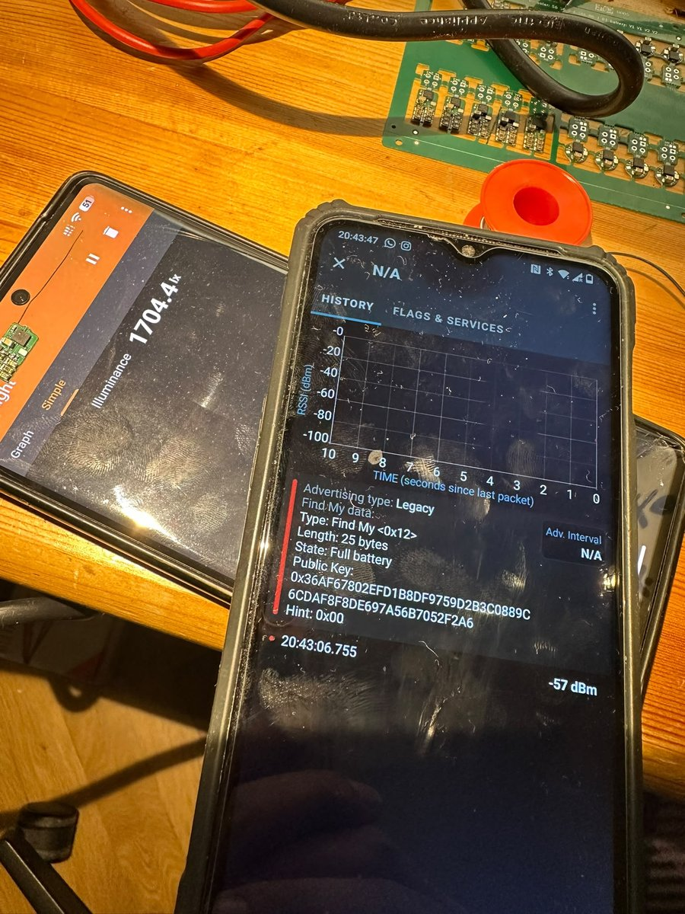

# Roadmap

Where gantu-tag goes after the v8.3 pilots. Written 19 November 2026, the day the first panels arrived. The order of
priority is **lighter, then simpler, then cheaper**: cost is already low, while mass decides which insects can carry a
tag.

## Where we are (20 Nov 2026)

First bench results from one Hagalu S6, run from RAM with a plain copper wire antenna:

| | Result | Design estimate |
|---|---|---|
| Find My | Picked up by passing iPhones and reported 3× in 20 min (±76–102 m) | — |
| Light for steady adverts at 3 s | **≈ 1.9 klx** (phone lux meter, desk lamp); patchy at ≈ 1.5 klx | ≈ 4.5 klx in daylight |
| Mass, tail cut, with ≈ 30 mm wire, no epoxy | **0.242 g** (Voltcraft, 1 mg resolution) | 0.19–0.21 g |
| RSSI on the bench | ≈ −40 to −57 dBm with the tag a few cm from the phone | — |

| Weighed | Advertising under 1.7 klx (nRF Connect, Find My payload) |
|---|---|
|  |  |

**A walk through town (20 Nov 2026)** with two burned Hagalu tags running on light only: gantu_S6_01 on Find My
and Hagalu-002 on Hubble. Both were reported, including from inside a supermarket under ordinary shop lighting.
Find My gave well over a hundred sightings that afternoon (±73–102 m); Hubble gave 25 packets, each with the
relaying phone's location (±2.4 m on the packet shown) and the decrypted sensor payload. Screenshots are in the
[build guide](guide.md#8-follow-it).

Two things to resolve from this:

- **It runs in less light than simulated.** Either the photodiodes give more than the datasheet suggests, the
  supervisor's window is wider, or the phone lux meter reads high. A photodiode's short-circuit current under the
  same lamp settles it.
- **It is ≈ 35–50 mg heavier than estimated.** Weighing a bare board from the panel splits that between the board and
  the parts.

## Stage 0: bench work on the v8.3 boards (now)

Nothing new to order. Each item answers a question that the next revision depends on.

- [ ] **Mass split:** weigh a bare Hagalu and a bare Irulu body (tail cut), an assembled one, then with antenna, cell
      and epoxy. This turns the estimates in the READMEs into measurements.
- [ ] **Irulu bring-up:** V1 first (SparkFun values), then V2 with the CHIP_EN load test. Weigh it with a 337.
- [ ] **Hagalu variants:** S6L and N6. N6 has no supervisor; if it starts cleanly, the start circuit can lose two parts.
      Find My keys for Hagalu-003 to Hagalu-020 are made and on the dashboard: Hagalu-003 and -004 go on S6L,
      Hagalu-005 on an N6, Hagalu-006 to -011 on the S6 boards (Hagalu-007 tries +4 dBm in RAM first), and the
      rest wait for the S6L and N6 results
      ([plan](tags.md), [why](#what-each-variant-tests)). Burned on 22 Nov 2026: Hagalu-003 (0 dBm, 3 s) and -004
      (+4 dBm, 6 s) on S6L both run on solar. Hagalu-005 on N6 went silent after its burn, so Hagalu-018 to -020
      stay unburned until [its check](pi-bench.md#hagalu-005-n6-startup-check) shows why. Hagalu-006 followed on an
      S6 (0 dBm, 3 s) as the S6 comparison.
- [ ] **Voltage- or current-limited in dim light?** Watch VCC across C1 at ≈ 1.5 klx. Stuck just below the 1.69 V
      start level means voltage (more or better cells); rising past it and draining means current (bigger cells or
      smaller bursts).
- [ ] **Smaller C1:** hand-swap C1 on two S6 and two Irulu tags to 47 µF 0603. If they still complete every advert
      (one-channel advertising if needed), v9 saves ≈ 13 mg per tag and Irulu can shrink.
- [ ] **Range, not RSSI:** walk-away test in the open with the tag at insect height, at 0 dBm and +4 dBm (the
      maximum). Also the time from first light to the first Find My report.
- [ ] **Coating:** light threshold and mass before and after epoxy over the photodiodes.
- [ ] **Antenna:** single wire vs dipole (AE1 + AE2) on range.
- [x] **Hubble:** Hagalu-002 burned on 20 Nov 2026 with VCC, temperature and advert count in the encrypted payload
      ([programming](programming.md#network-payloads), [record](tags.md)). On a walk the same evening Hubble
      reported it 25 times and decoded every packet.
- [ ] **Why the count stays at 0:** every packet checked from Hagalu-002 on its own reads **1.562 V and advert
      count 0**, even packets 4 s apart, and Hubble reports its uptime counter as 0 too. On the adapter (3.4 V) the
      count rose by one per advert. Either the IN100 restarts before each advert, or it doesn't keep its counters at
      this voltage. Run it from ≈ 1.6 V on the bench and watch. Meanwhile the rotating ID stays at period 0, so it
      doesn't rotate on Hagalu (like Find My's static key), and Hubble keeps decoding it. The likely reason is the
      start circuit itself: in dim light an S tag starts at 1.69 V, sends one advert and switches off, so every packet
      is the first after a start ([below](#what-each-variant-tests)). If VCC stays above 1.67 V in brighter light,
      the IN100 stays on and the count should climb. At the lamp ramp's brightest step (about 23.6 klx), Hagalu-003
      and -004 still restarted for every advert ([ramp](pi-bench.md#observed-solar-reception-gaps)). Later lamp
      runs show tags sending at exactly their programmed intervals, as if they stayed on
      ([two regimes](pi-bench.md#two-regimes-in-one-run)). Neither had VCC or the light at the tag measured. Decode
      Hagalu-002's packets locally in sun.
- [ ] **Nitinol antenna and silver-epoxy joints:** see [below](#antenna-and-joints-without-solder). Glue nitinol
      wire to two tags of each kind and compare RSSI and range with copper on the same tags.
- [ ] **Dip per advert:** on one S6, scope VCC and CHIP_EN on the tail through single adverts at 0 and +4 dBm, from
      the bench supply through a large resistor and from the lamp. The dip and its recovery give C1's real
      capacitance and the charge per advert, which set the VCC gate ([model](#spending-the-light-the-charge-model)).
- [ ] **Two networks at start-up:** Find My ungated and Hubble gated on VCC on one S6, in RAM, from dark under a slow
      light ramp, with VCC on the tail. Pass: no Hubble advert at a start, and no lock ([why](#a-second-network)).
- [ ] **Hubble on a VCC trigger:** in RAM, gate the Hubble set on VCC and check that it stays silent while the tag
      restarts for each advert and sends once the tag stays on ([how](#a-second-network)).
- [ ] **Power against rate, again:** a second balcony day with Hagalu-003 and -004 swapped in place, to separate
      +4 dBm from placement ([why](#detection-power-rate-and-channels)).
- [ ] **One channel against three while restarting:** adverts per minute at the same light, in RAM. This shows how
      much of each start-up cycle the radio really is.

### What each variant tests

The panel carries several start circuits on the same copper because the IN100 datasheet leaves three things out:
how soon after CHIP_EN goes high it sends its first advert, the CHIP_EN level at which it turns off, and how much
current CHIP_EN draws. Each variant is a bet on one of them.

| Variant (on 2 panels) | Start circuit | What it tests | Where it stands (22 Nov 2026) |
|---|---|---|---|
| **Hagalu S6** (8) | The TPS3831 starts the IN100 once C1 reaches 1.69 V; C5 holds CHIP_EN through the advert's dip; R2 3.3 MΩ lets it fall in ≈ 1 s | The safe build, if the first advert comes straight after start. If it came one interval later, CHIP_EN would already be gone and S6 would be silent in dim light | Hagalu-001 advertises in patchy light (≈ 1.5 klx), where S6 restarts for every advert. That only works if the first advert comes at once, so S6 is the field build (inferred; watching VCC on a tail confirms it). Hagalu-003 and -004 back it: in bright lamp light they sent every ≈ 2.1 s, sooner than their 3 s and 6 s intervals, so the first advert comes before one interval has passed |
| **Hagalu S6L** (8) | The same, with R2 10 MΩ (≈ 3.3 s) | The fallback for a late first advert. Its own risk: if the IN100 stays on down to a low CHIP_EN, it sends a second advert, takes VCC under 1.1 V and locks until dark | The late advert it guards against doesn't seem to happen, so the lock is what's left to test. Hagalu-003 and -004 run on solar after their burns. In a dimming lamp ramp neither showed a second advert per start, but Hagalu-003 stopped first at 1.59 klx. Its 3 s interval is inside the ≈ 3.3 s hold, while 004's 6 s isn't ([ramp](pi-bench.md#observed-solar-reception-gaps)). Still to do: a slow dawn ramp with VCC watched on the tail. If it locks, make the rest S6 before burning (R2 to 3.3 MΩ, or a 4.7 MΩ stacked on R2 for ≈ 3.2 MΩ) |
| **Hagalu N6** (4) | No supervisor: R1 1 MΩ from VCC to CHIP_EN, with C5. The IN100 starts wherever its power-on reset lets go | Whether the start circuit can go (two fewer parts). Predicted to lock below ≈ 5 klx, and it needs CHIP_EN to draw under ≈ 0.5 µA | Hagalu-005 ran in RAM, was burned on 22 Nov and has been silent since, also on 3.3 V DC. The pre-burn CHIP_EN check wasn't recorded. Next: read CHIP_EN at C5 (≈ VCC means no load) and the supply current on 3.3 V ([check](pi-bench.md#hagalu-005-n6-startup-check)). Hagalu-018 to -020 stay unburned |
| **Irulu V1** (8) | R1 1 MΩ / C2 100 nF: CHIP_EN rises ≈ 0.1 s after the cell is fitted | The simple battery build: fit the cell and it runs | Waiting for cells. Its CHIP_EN load test needs no cell and answers N6's 1 MΩ question too |
| **Irulu V2** (8) | R1 100 kΩ / C2 10 nF and the OFF bridge on the tail: silent until the tail is cut | Cut-to-start, and the hedge if CHIP_EN loads a 1 MΩ enable (copes with a 150 kΩ pull-down or ≈ 5 µA) | Waiting for cells. Draws 15.5 µA while OFF is bridged (≈ 22 days on a 337) |

S6 ↔ S6L is one 0402 resistor and V1 ↔ V2 two, so whichever wins, every S tag and every battery tag can follow it.

## Detection: power, rate and channels

Written 25 November 2026. The aim is the most Find My reports from an insect that spends most of its time away from
people and only sometimes passes them, so a report a day already counts. Transmit power, interval and channels are
all OTP settings; the question is which one to spend charge on.

**The balcony run** ([record](pi-bench.md#south-facing-balcony-run-24-november-2026)), one tag per setting, one day:

| Tag | Board and setting | Pi receptions | Median gap | Find My, 5-min windows |
|---|---|---:|---:|---:|
| Hagalu-003 | S6L, 0 dBm, 3 s | 4,012 | 5.49 s | 41% |
| Hagalu-004 | S6L, +4 dBm, 6 s | 3,824 | 5.33 s | **57%** |
| Hagalu-006 | S6, 0 dBm, 3 s | 5,833 | 3.40 s | 40% |

- **Power helped; rate didn't.** Hagalu-006 sent about 45% more adverts than -003 and got the same coverage.
  Hagalu-004 sent the fewest and got the most.
- **The interval setting hardly mattered.** Hagalu-004's median gap is shorter than its 6 s setting, so it was mostly
  restarting for each advert, where the light sets the rate, not the interval. Over the day it sent only 5% fewer
  adverts than -003; under the lamp, where light alone set the pace, its gaps were 23–30% longer, and that is the
  better measure of what +4 dBm costs.
- **Find My doesn't report every advert.** About 4,000 receptions per tag became about 90 Find My observations. Near
  a phone that already hears the tag, more adverts add little; more finders in range add reports.
- **Caveats.** Hagalu-004's median RSSI at the Pi was 8 dB above -003's, twice the 4 dB setting, so placement or
  antenna adds to its lead. 57% against 41% over the same 100 windows is about two standard errors. The swapped
  repeat in Stage 0 separates the two. The tags' 0.5–1 °C temperature differences fit uncalibrated per-chip offsets:
  at ≈ 10 µW average the tag can't measurably warm itself, at either power.

**For an insect passing people**, the expected reports scale with the finders in range, times how long each stays in
range, times adverts per second. Range enters twice: a wider strip of passers-by and a longer pass for each. +4 dB
is about 1.6× the range in free space and 1.35× in clutter, so roughly 1.8–2.5× the reports for ≈ 20–25% fewer
adverts while the light sets the rate: still ≈ 1.4–2× ahead. Rate enters once, and in dim light the light sets it anyway.

**Channels.** Legacy advertising uses only channels 37, 38 and 39, and phones listen for Find My and Hubble only
there. One 31-byte advert lasts ≈ 0.4 ms per channel at 1 Mbps, and the IN100 sends all three within ≈ 1–2 ms. A
phone listens on one channel for a scan window (tens to hundreds of ms), then moves to the next. With three channels,
whichever one it's on hears the advert; with one, about a third of the time. Missed adverts come mostly from phones
that aren't scanning at that moment, not from the wrong channel. The estimate of ≈ 16 µC on three channels against
≈ 6 µC on one would offset the loss only if all the saving became rate; while the tag restarts for each advert,
part of each cycle is start-up, so the saving is smaller. Keep three channels unless the Stage 0 test says
otherwise.

### Spending the light: the charge model

[`advert_budget.py`](../hagalu/tools/advert_budget.py) ([output](../hagalu/docs/advert_budget.txt)) puts the
solar model's photodiode string and C1 (≈ 55 µF effective) together with the lamp ramp and the balcony logs. Its
numbers are estimates until the Stage 0 scope trace measures the dip per advert.

- **Charge per advert.** Fitting the lamp ramp's restart gaps gives ≈ 28 µC per start at 0 dBm and ≈ 36 µC at
  +4 dBm, if a white LED gives a third of daylight's photocurrent per lux (≈ 20 and 25 µC if a quarter). Taking off
  ≈ 4.5 µC of start-up leaves ≈ 24 and 32 µC per advert. **+4 dBm costs ≈ 27% more per advert** under either
  calibration. On 55 µF one advert drops VCC by ≈ 0.44 V at 0 dBm and ≈ 0.57 V at +4 dBm, about 3× the 0.16 V
  assumed from the 100 µF label. C1's real capacitance at 1.7–2.5 V is the biggest uncertainty here.
- **Three regimes.** In dim light the tag restarts for every advert, as fast as the light recharges C1 (≈ 14 s at
  2 klx, ≈ 2.7 s at 10 klx, ≈ 1.4 s at 20 klx, +4 dBm). The CHIP_EN hold sets a floor on how fast that can go: ≈ 0.6 s
  on S6, ≈ 1.1–1.7 s on S6L (balcony). In strong light the tag stays on at its set interval, and anything the light
  pays for beyond that interval charges C1 up towards the string's float voltage and is wasted.
- **The most the light pays for while staying on** (+4 dBm, 25 °C): ≈ 0.36 adverts/s at 10 klx, 0.84 at 20 klx,
  1.8 at 40 klx, 4.6 in full sun. It can stay on at all from ≈ 6 klx at 25 °C and ≈ 15 klx at 40 °C.
- **To use all the light, set the interval short.** Restarting already spends all the light; staying on at a long
  interval wastes what's left over. Find My at **1 s** keeps the tag restarting up to ≈ 24 klx (≈ 27 klx at 40 °C) and sending once a
  second above that. This needs **S6**: on S6L the ≈ 3 s hold lets two or three adverts follow each start, which
  takes VCC under 1.1 V in dim light (the lock).

**Default for field tags:** S6, Find My at **+4 dBm, three channels, 1 s**.

### A second network

Two advertising sets run on independent intervals ([bench notes](in100-config.md#stagger-find-my-and-hubble-adverts)).
While the IN100 stays on, jitter slides them past each other (closest pair seen: 13.5 ms). At start-up both sets
advertise within 1.6–2.5 ms whatever their order, and in dim light every advert is a start-up advert, so co-prime
intervals and set order can't separate them.

- **A packet cut short is harmless.** Each channel's packet stands alone; one cut off by a voltage drop fails its CRC
  and receivers ignore it. A restart is harmless too.
- **The lock isn't.** Two +4 dBm adverts after a start take ≈ 1.1 V off C1, from 1.69 V to ≈ 0.55 V, well under the
  IN100's 1.1 V. **Never run two ungated sets on Hagalu.**
- **Gate the second network on VCC.** A set can be triggered on VCC
  ([trigger settings](in100-config.md#other-settings-by-cfg-section)). Every start begins at ≈ 1.69 V, so a gate well
  above that never fires at a start. At **≈ 2.3 V** (55 µF) a Hubble advert leaves the tag on, and a Hubble and a Find
  My advert back to back stay clear of the lock. The gate moves with C1: ≈ 2.55 V at 45 µF, 2.15 V at 72 µF, 2.05 V
  at 100 µF.
- **When the gate opens.** With Find My at 1 s, VCC reaches 2.3 V from ≈ 24 klx at 25 °C (≈ 29 klx at 40 °C); with
  Find My at 3 s, from ≈ 10 klx (≈ 20 klx). In full sun the spare light pays for a Hubble advert every ≈ 0.3 s, and
  when a cloud comes VCC falls from 2.3 V to 1.67 V in ≈ 1 s at a 1 s Find My interval, so the gate closes before it
  matters.
- **Hubble's cap.** Hubble lists at most 1,024 adverts a day. A tag gated on sun sends a lot more than that at a
  short interval: 1 s for 1.5 h is 5,400. Set the Hubble interval from the hours of strong sun at the site, e.g.
  ≈ 11 s for 3 h, ≈ 22 s for 6 h, and ask Hubble what happens above 1,024 (a billing limit, a rejected packet, or a
  reused sequence number).
- **Steady sun keeps all three tags on.** On 25 November (Pi, per-minute receptions) Hagalu-003, -004 and -006
  sent at their set intervals in 80–97% of minutes from 13:30 to 15:00 CET (≈ 17 of 20, 9 of 10 and 17.5 of 20 a
  minute). In the rising and patchy light before that, -004 and -006 restarted faster than their intervals (-006 up
  to 90 a minute, ≈ 0.7 s; -004 up to 35, ≈ 1.7 s), while -003 (S6L, 3 s) never went above its interval rate: its
  hold keeps it on until the next advert. Neither day showed a lock: no tag dropped out while the others were
  sending, and the only long silences were at first and last light.
- **Untested:** whether the trigger is checked before the first advert after a start; whether a triggered set keeps
  advertising at its interval while VCC stays above the threshold; the zero-key first Hubble packet seen in RAM with
  two sets.

### A third network: Google's Find Hub

The IN100 has three advertising sets, so Find Hub (Google's network of Android phones) could be the third.
GoogleFindMyTools registers custom trackers with a fixed advertisement key (ESP32 and Zephyr firmware so far), much
as OpenHaystack does for Find My; a fixed Find Hub frame should fit an IN100 set. In most of the world Android
phones far outnumber iPhones. Two limits: by default Android waits until several phones have heard a tracker before
reporting it, which works against rare passes in the field, and the locations can only be read through the tool's
Python script. Gate it like Hubble, or, where Android dominates, swap it with Find My as the ungated network.
Hubble's satellites use their own protocol, so the IN100's ordinary adverts reach Hubble's phone gateways only.

## Stage 1: v9, flex (both tags)

One structural change, the same proven circuits.

- **Polyimide flex** (≈ 0.1 mm) instead of 0.6 mm FR4, with a thin polyimide stiffener under the IN100 and crystal
  only. On both tags the board is the biggest single part of the mass. JLCPCB makes and assembles flex boards
  ([capabilities](https://jlcpcb.com/capabilities/flex-pcb-capabilities),
  [stiffeners](https://jlcpcb.com/blog/pcb-stiffeners-guide)); check its current minimum size and whether it will
  place a QFN on flex before laying out v9.
- **Antenna as a copper trace on a flex tail** (≈ 30 mm), instead of a hand-soldered wire. Every tag gets the same
  antenna, and the last hand step on Hagalu goes away. If a trace proves too fragile on the insect, use glued
  nitinol wire instead (next section).
- **Thinner copper** (½ oz) and a hatched ground pour.
- **C1 47 µF 0603** if the Stage 0 swap passes.
- **IN100 in DFN8** (2.5 × 2.5 mm) if JLC stocks it and the bench confirms programming over its pins. It's a smaller
  step than WLCSP and needs no X-ray.

| | v8.3 (0.6 mm FR4) | v9 target (flex) |
|---|---|---|
| **Hagalu** (with antenna, no epoxy) | **0.242 g measured** | ≈ 0.13–0.16 g |
| **Irulu**, without cell | ≈ 0.12 g (estimate; weigh it) | ≈ 0.06–0.07 g |
| **Irulu** with a 337 cell (0.13 g) | ≈ 0.25 g | ≈ 0.19–0.20 g |

Flex will cost a little more per tag than rigid FR4, not less.

## Antenna and joints without solder

Soldering is the slowest and least repeatable hand step: a 31 mm wire onto a 1 mm edge pad on every tag, and on
Irulu a wire to a cell that must never be heated. Gluing is easier to do in bulk: dot epoxy onto a row of tags,
lay the wires in, and cure them all at once.

- **Silver conductive epoxy for every joint.** Two-part silver epoxy such as
  [MG Chemicals 8331D](https://mgchemicals.com/products/adhesives/electrically-conductive-adhesives/silver-epoxy/)
  ([datasheet](https://mgchemicals.com/downloads/category-data-sheets/CDS-ElectricallyConductiveAdhesives.pdf))
  cures in ≈ 6 h at room temperature or 10 min at 65 °C, with about 20 min working time. Its resistivity,
  ≈ 2 × 10⁻³ Ω·cm, is negligible over a 1 mm joint. It's already the method for Irulu's cell; use it for the
  antenna wires too.
- **Superelastic nitinol wire for the antenna.** Nickel-titanium wire springs back straight after bending, where
  copper kinks and stays bent, and it is lighter. It can't be soldered without special flux (its oxide), which is
  one more reason to glue it. Sources sell 0.1–0.2 mm superelastic wire by the foot or on spools:
  [Nexmetal](https://nexmetal.com/products/nitinol-superelastic-wire),
  [Goodfellow](https://www.goodfellow.com/eu/nitinol-shape-memory-alloy-spooled-wire-1000069755) (0.125 mm),
  [McMaster-Carr](https://www.mcmaster.com/nitinol-wire). Pick an austenite finish (Af) below the field
  temperature, so it stays superelastic outdoors.

  | 31 mm arm | Copper | Nitinol |
  |---|---|---|
  | Mass at 0.1 mm | ≈ 2.2 mg | ≈ 1.6 mg |
  | Mass at 0.2 mm | ≈ 8.7 mg | ≈ 6.3 mg |
  | Extra loss at 2.44 GHz, 0.2 mm (estimate) | — | ≈ 0.2–0.4 dB |
  | Extra loss at 2.44 GHz, 0.1 mm (estimate) | — | ≈ 0.5–0.9 dB |

  Nitinol conducts about 50 times worse than copper, but at 2.44 GHz the current flows in a ≈ 9 µm skin, so the
  loss resistance of a quarter-wave arm is only 2–4 Ω against tens of ohms of radiation resistance. Estimates from
  skin depth; measure RSSI against copper on the same tag.
- **Test (Stage 0):** two Hagalu and two Irulu with glued nitinol dipoles. Abrade the wire end just before gluing.
  Compare RSSI at a fixed distance with copper, then bend the wire repeatedly and check it springs back and the
  joint holds. If it passes, the build guide switches to glued nitinol, and the soldering iron is needed only if a
  tag is reworked.

## Stage 2: v10, chip-scale (toward the CTT class, 40–50 mg)

- **IN100 WLCSP10, 1.1 × 2.0 × 0.35 mm**, if JLC can source and place it.
- **0201 passives** (Standard PCBA places them) and the smallest 26 MHz crystal that meets the IN100's spec.
- **Hagalu:** fewer or smaller photodiodes, sized from the Stage 0 light measurements. Outdoors there is several
  times more light than the tag needs.
- **Irulu: a board no bigger than the cell.** The 337 is Ø 4.8 mm; with WLCSP and an 0603 C1 the board could be
  Ø ≈ 5 mm. The tag becomes "a 337 with a chip on it".

| | v10 target |
|---|---|
| **Hagalu** | ≈ 0.05–0.07 g |
| **Irulu**, without cell | ≈ 0.03–0.04 g |
| **Irulu** with a 337 | ≈ 0.16–0.17 g |

## The battery tag's floor

On Irulu the **cell is the floor**. A 337 (SR416) weighs 0.13 g, about half of today's tag, and it's the smallest
common silver-oxide cell. It also lasts ≈ 57 days at 3 s, while most deployments need 1–3 weeks, so there's no reason
to fit a bigger one. Flex and chip-scale parts can take the rest of the tag from ≈ 0.12 g down to ≈ 0.03–0.04 g, but
the total can't go much below ≈ 0.16 g without a smaller cell.

## Cost

| | Now (per tag, parts + JLC placement) | Outlook |
|---|---|---|
| **Irulu** | ≈ €2.30 + cell | Close to the floor: the IN100 (≈ $2.60) is most of it. Flex adds a little. |
| **Hagalu** | ≈ €7 | The six photodiodes (≈ $0.87 each) are most of it. Fewer or cheaper cells is the lever. |

The one-off fees (≈ €100 per order) are what dominate small orders; ordering 100+ tags spreads them.

## Ruled out

- **0.4 mm FR4 as a halfway step.** JLC makes 0.4 mm boards only with ENIG and not as panels, which makes assembly
  awkward, and it saves only a third of the board's mass. Go straight to flex.
- **A one-chip solar string (IXYS CPC1822).** Obsolete, in a heavy SOIC-8 package, and only ≈ 50 µA in direct sun.
- **Boost converters and supercapacitors** on Hagalu. More parts and more mass than the photodiode string they'd
  replace.
- **Bigger cells on Irulu** for routine use. A 337 already outlasts a typical deployment.
