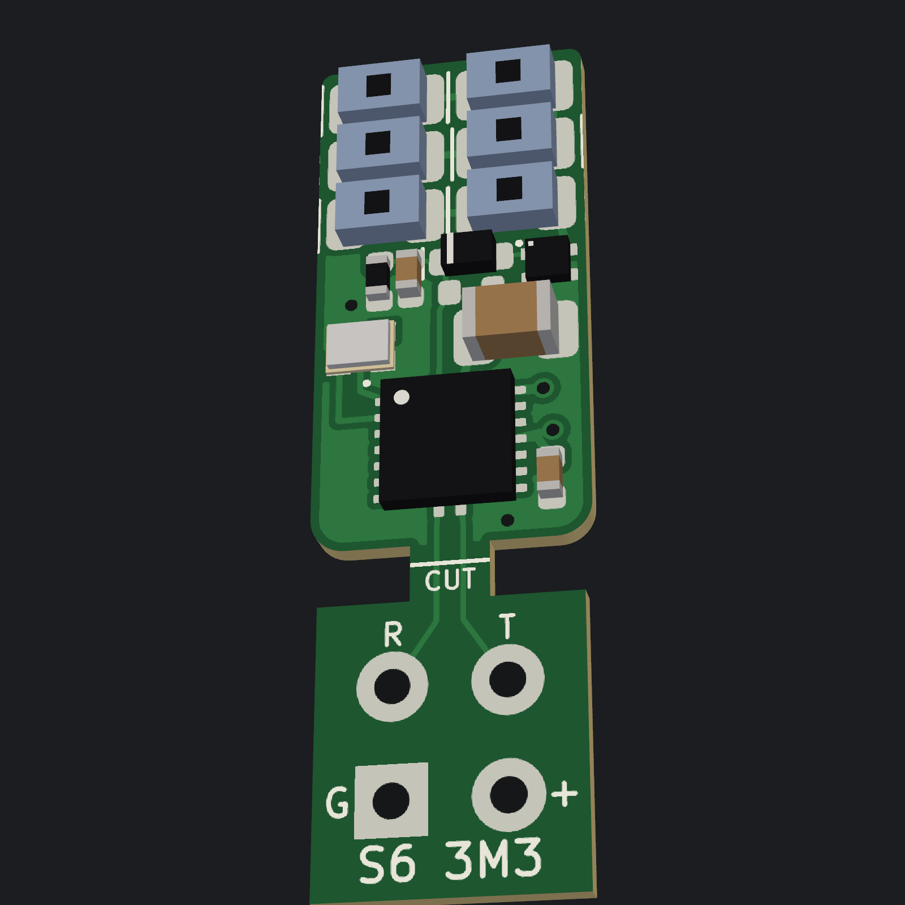
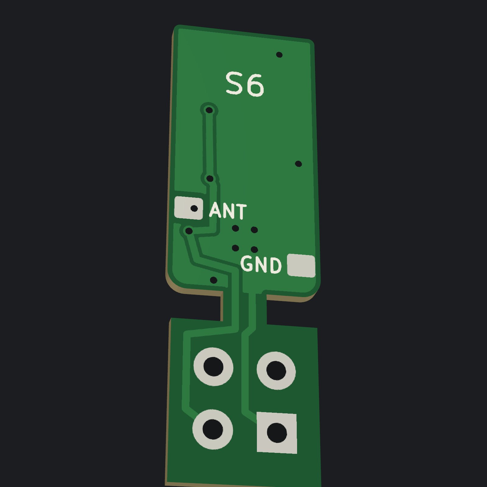
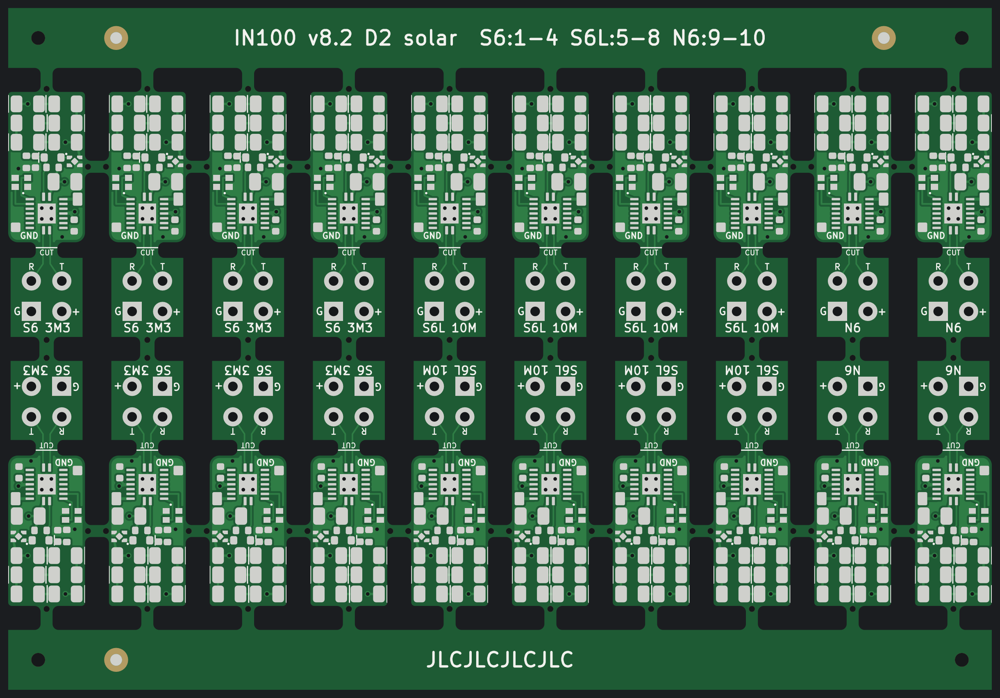

# IN100 insect tag v8.3 D2: compact solar tag, S6 / S6L / N6

A battery-free IN100 NanoBeacon tag, **6.4 × 12.55 mm (about 1 : 2)**. Six broadband photodiodes in a 2 × 3 block
cover the top half and the IN100 sits in the bottom half. A programming tail at the bottom is cut off after
programming. The photodiode string charges a 100 µF capacitor directly: no blocking diode, no supercap, no boost
chip. On the S variants a 1 × 1 mm supervisor starts the IN100 only once the capacitor holds enough charge for a burst.

The tag works **in light only** and keeps no clock overnight. That is fine for Find My; for Hubble the time counter
restarts every morning.

JLCPCB fits every part, top side only. You add the antenna wire(s). Derived from v7, D1 and D2 v8.0/v8.1.

## v8.3 (this revision): final test order

- **0.6 mm board**, ordered on one combined panel with D1. See `../panel/README.md` for the order,
  the variant counts and the reasoning.
- **Antenna pads moved to the underside**, which carries no parts.
  - Two 1.2 × 1.0 mm edge pads: **AE1 (ANT)** on the right edge, level with the IN100, and **AE2 (GND)** at the lower
    left. Nothing but solder-masked pour is within 0.25 mm of either.
  - v8.2's top pads sat 0.17 mm from C1's GND pad and 0.43 mm from IN100 pins.
  - RF_TX reaches AE1 through one via inside the pad; the underside VCC trunk was rerouted inboard to clear it.
- **Wide tabs on the tail** (3 mm at the end, 2 mm on each side) keep the 0.6 mm panel stiff. The tail is cut off,
  so its nubs don't matter.
- Unfitted parts get no solder paste on the panel (R1's empty pads on S6/S6L sit 0.155 mm from D2).
- Circuit, values and part placement otherwise as v8.2.

| Top | Bottom |
|---|---|
|  |  |

Flat previews with every track are in `docs/pcb_preview.png`; the schematic is `docs/schematic.pdf`.

## What changed from v8.1 (the 4.5 × 24.6 mm rod), and why

| | v8.1 rod | **v8.2 compact** | Why |
|---|---|---|---|
| Shape | 4.5 × 24.6 mm, 1 : 5.5 | **6.4 × 12.55 mm, 1 : 1.96** (13.0 mm with the neck stub), 80.8 mm² | You asked for 1 : 2. The photodiodes run lengthwise, two side by side |
| Photodiodes | 7 in one row, plus a 0 Ω six/seven selector | **6 in a 2 × 3 block**, snake-wired | Six is the most that stays under 3.6 V in cold sun |
| Blocking diode | RB751S40 between the string and C1 | **None** | It cost ≈ 0.15 V of string voltage, roughly half the light at the start threshold. It only mattered in the dark, when the tag is off anyway |
| Capacitors | C1 100 µF + C3 10 µF + C4 100 nF | **C1 100 µF + C4 100 nF** | C3 added only ≈ 5–8 µF |
| Fitted parts (S6) | 17 (S7) | **13**: IN100, crystal, C1, C4, 6 photodiodes, U2, D2, C5, R2 | Fewer parts, and every one is needed |
| R2 (CHIP_EN hold) | 10 MΩ | **3.3 MΩ on S6, 10 MΩ on S6L** | Independent review F3/F6, see "Variants" |
| Antenna pads | Edge pads | v8.2: top edge pads. **v8.3: underside edge pads, AE1 (ANT) right, AE2 (GND) lower left**, labelled beside each pad | Easy to solder: no parts on the underside |
| Mass | ≈ 0.24 g (0.8 mm, FR4 only) | **≈ 0.19–0.21 g on 0.6 mm** (v8.3; 0.22–0.24 g on 0.8 mm) | See "Mass and size": the board itself is most of it |

## Independent review

A separate agent re-derived the design from datasheets and first principles, without seeing the design notes. It found
no blocker in copper, pinouts or polarities. What it changed:

- **F1, capacitor:** C1 is ≈ 55 µF at 1.5 V, not 80–88 µF. Murata's own model gives 72 µF at 0 V before DC bias;
  ≈ 45 µF is the worst case. All numbers below use 55 µF, with 45 µF as the worst case.
- **F3 / F6, unpublished CHIP_EN behaviour:** the IN100 datasheet gives only "≥ 0.6 VCC is high". There is no turn-off
  level and no first-advert latency.
  - With R2 10 MΩ, an IN100 that stays on down to a low CHIP_EN sends a second advert 3 s later, takes VCC under
    1.1 V, and locks.
  - With R2 3.3 MΩ that can't happen, but if the IN100 waits one interval before its first advert, it turns off
    before sending anything in dim light.
  - **The panel carries both, S6 (3.3 MΩ) and S6L (10 MΩ), so the first tags settle it.**
- **F7:** N6 (no start circuit) is expected to lock in anything dimmer than ≈ 5 klx. It stays on the panel as a small
  labelled experiment: 4 tags instead of 8.
- **F11:** programming at 3.3 V forward-biases the dark photodiode string (up to ≈ 7 mA). Use a ≥ 100 mA 3.3 V supply.
- **F5:** InPlay's June 2026 datasheet (V2.4) drops IN100-Q1-R-RC1I from the ordering table. Buy what you need now.
- **Confirmed:** 1.5 µA per klx of sunlight; the open-circuit voltages; ≤ 3.47 V in cold sun; removing the
  blocking diode is fine; the TPS3831 pinout and that MR may float; the crystal is in spec.

Full report: `docs/independent_review.md`.

## Circuit

- **IN100 core:**
  - Parts: U1 IN100 (C6062024), Y1 26 MHz 1612 crystal (C5203638), **C1** 100 µF 0805 (C141660), **C4** 100 nF at
    VDDQ (pin 13), four vias in the exposed pad.
  - U1 sits at 0°: CHIP_EN/VCC face the start circuit above it, the UART faces the tail, the crystal is at the upper
    left, and RF_TX (pin 16) points straight at AE1.
  - VDDQ is tied to VCC, as on SparkFun's board.
- **Harvester:** PD1–PD6 Vishay TEMD7000X01 (0805, 350–1120 nm, C145328) in series, anodes towards VCC, straight
  onto C1.
  - The string snakes PD1 (top left) → PD2 → PD3 → PD4 → PD5 → PD6 (bottom right); each link is a short hop.
  - PD1's cathode goes to GND through a via between its pads.
- **Start circuit (S6, S6L):**
  - **U2 TPS3831G18DQNR** (C2066667; 1.67 V, 17 mV hysteresis, 150 nA typ / 500 nA max, push-pull). 200 ms after
    VCC passes 1.69 V, its output goes high and charges CHIP_EN through **D2** (RB751S40, C232576).
  - **C5** 330 nF (C107013) holds CHIP_EN when a TX burst pulls VCC under 1.67 V and U2 drops its output.
  - **R2** lets CHIP_EN fall: S6 3.3 MΩ (C270613, τ 1.1 s), S6L 10 MΩ (C26082, τ 3.3 s).
  - In good light VCC stays above 1.67 V and U2 holds CHIP_EN high, so the IN100 advertises continuously.
  - In dim light the IN100 starts at 1.69 V and sends its advert (VCC drops to ≈ 1.34 V). On S6 it then switches off;
    the capacitor recharges and the cycle repeats.
  - U2's MR input is left open (internal 20 kΩ pull-up). Standby with the IN100 off is ≈ 0.16 µA.
- **No start circuit (N6):** **R1** 1 MΩ (C26083) from VCC to CHIP_EN, with C5. U2, D2 and R2 are not fitted.
  CHIP_EN follows VCC, so the IN100 starts wherever its internal power-on reset lets go.
- **Bottom side:** a GND pour, the VCC trunk (string end → C1 → VDDQ → neck) and the GND lane through the neck. No parts.

## Simulation

`tools/solar_sim.py`; full output in `docs/solar_sim.txt`.

**Model:**

- TEMD7000X01: Vo = 350 mV and Ik = 3 µA at 1 mW/cm² (950 nm), −2.6 mV/K. Sunlight gives **1.5 µA per klx** (the
  review's ASTM G173 check gives 1.41–1.47). Diode ideality 1.2.
- Capacitor: **55 µF effective**.
- IN100: 16.2 µC per advert at 0 dBm on 3 channels, 0.625 µA asleep, 3 µC to boot, 3 s interval.
- Enable: on when CHIP_EN > 0.6 VCC; off below *k* × VCC, with *k* = 0.45 or 0.2 since it is not published.
- **STUCK** means VCC fell below 1.1 V while the IN100 was on: brown-out lock, which needs VCC < 0.1 V to clear.

**Adverts per minute**, 10 minutes from an empty capacitor, 25 °C (20/min = the 3 s interval):

| | 0.2 klx | 0.5 klx | 1 klx | 2 klx | 5 klx | 10 klx | ≥ 20 klx |
|---|---|---|---|---|---|---|---|
| **S6** (3.3 MΩ), *k* 0.45 | 0 | 1.0 | 3.2 | 7.6 | 20.9 | 43* | 20 |
| S6, *k* 0.2 | 0 | 1.0 | 3.1 | 7.4 | 20.5 | 43* | 20 |
| S6, worst case: 45 µF, 19 µC, *k* 0.2 | 0 | 1.0 | 2.9 | 6.7 | 18.2 | 38* | 20 |
| **S6L** (10 MΩ), *k* 0.45 | 0 | 0.9 | 3.1 | 7.3 | 20.4 | 20 | 20 |
| S6L, *k* 0.2 | 0 | **STUCK** | **STUCK** | 8.2 | 19.6 | 20 | 20 |
| S6L, worst case | 0 | **STUCK** | **STUCK** | **STUCK** | 19.6 | 20 | 20 |
| *If the first advert waits one interval:* S6 | 0 | **0** | **0** | **0** | 19.5 | 20 | 20 |
| … S6L, *k* 0.2 / 0.45 | 0 | 0.9 / 0 | 2.9 / 0 | 7.6 / 5.4 | 19.5 | 20 | 20 |
| **One advertising channel** (6.2 µC), S6 | 0 | 1.6 | 5.8 | 14 | 40* | 20 | 20 |
| N6, power-on reset at 1.0 / 1.3 V | STUCK | STUCK | STUCK | STUCK | STUCK | STUCK | 20 at 100 klx |

\* Above the 3 s rate: S6 restarts as soon as VCC is back at 1.69 V, and every start sends an advert at once. It
advertises as fast as the light allows. This is harmless.

What the table says:

- **S6 never locks**, as long as the IN100 sends its first advert right after it starts. **S6L survives a late first
  advert**, but can lock in dim light if the IN100 stays on down to a low CHIP_EN. The first S6 and S6L tags show
  which applies (see "Bring-up").
- **Burning the OTP for one advertising channel** cuts the charge per event to ≈ 6 µC. That roughly doubles the
  dim-light rate and removes every lock in the review's runs. The cost: a scanner sees the tag only while it listens
  on that channel.
- **Light to start** (25 °C): about 0.3–0.5 klx, which is bright indoor light. At 40 °C it is about 1 klx; with
  U2 at its 500 nA maximum, about 0.6 klx at 25 °C. Below that the string can't lift C1 to 1.69 V, so the tag waits.
- **Continuous 3 s adverts need ≈ 4.5 klx** (overcast daylight). Rough light levels: office 0.3–0.5 klx, close under
  a desk lamp 1–2 klx, overcast daylight 5–20 klx, shade 10–25 klx, full sun about 100 klx.
- **Bench light misleads.** A white LED gives only ≈ 0.5 µA per klx (a third of sunlight's 1.5); halogen gives ≈ 4.
  Test in daylight, or measure one photodiode's short-circuit current.
- **Highest VCC** (full sun, IN100 off): 2.82 V at 25 °C, 3.15 V at 0 °C, 3.28 V at −10 °C. The review gives 3.17–3.47 V
  at −10 °C over ideality 1.0–1.5. That is under the IN100's 3.6 V maximum, but above 3.0 V: **don't use the on-chip
  VCC/temperature ADC** (it is specified only to 3.0 V).
- **No blocking diode:** in the dark C1 leaks back through the string (0.33 µA at 1.69 V, 26 µA at 2.5 V). It drains
  from 1.69 V to 1.1 V in about 2 minutes. That only matters when it's dark, and the tag is off then anyway.
- **One advert from 1.69 V** takes VCC to 1.34 V (55 µF) or 1.26 V (45 µF).

## Variants

| Variant | Combined panel (v8.3) | 2 assembled panels | U2, D2 | R2 | R1 | Tail silk |
|---|---|---|---|---|---|---|
| **S6** | columns 1–2 | 8 | fitted | **3.3 MΩ** (C270613) | not fitted | `S6 3M3` |
| **S6L** | columns 3–4 | 8 | fitted | **10 MΩ** (C26082) | not fitted | `S6L 10M` |
| **N6** | column 5 | 4 | not fitted | not fitted | 1 MΩ (C26083) | `N6` |

The unit map is `../panel/docs/panel_units.csv`. (`PANEL_COLUMNS` in `design.py` and
`tools/make_fab.sh` still build v8.2's D2-only panel if you ever need it.)
- After the tail is cut, N6 is recognisable by its missing U2/D2.
- S6 and S6L look the same from the top; since v8.3 the variant is printed on the underside of the body.
- **S6 ↔ S6L is a one-resistor swap** (R2, 0402), so whichever wins, every S tag can run it.
- N6's 1 MΩ also depends on the IN100's unpublished CHIP_EN input current (it must stay under ≈ 0.5 µA). S6/S6L
  don't: U2 drives CHIP_EN.

## Programming

The programmer powers VCC at 3.3 V through J1. **It doesn't need to drive CHIP_EN.**

- On S6/S6L, U2 enables the IN100 0.2 s after 3.3 V appears and holds it on.
- On N6, R1/C5 enable it in about 0.3 s.

**Supply:**

- At 3.3 V the dark photodiode string draws up to ≈ 7 mA, on top of up to 50 mA for burning the OTP. Use a 3.3 V
  supply good for **≥ 100 mA**; an FT232R's 3V3OUT is too weak.
- **Apply + and G before R/T**, or put 1–4.7 kΩ in series with the adapter's TX. A powered UART line into an
  unpowered IN100 can back-power it and park it in an undefined state.
- Program in dim light.

**Wiring:** connect a 3.3 V USB-UART adapter to the tail: **T** → adapter RX, **R** → adapter TX, **G** → GND,
**+** → 3.3 V. This is the same 2 × 2 layout and pad order as D1 and v7, so the same pogo jig fits.

**Settings** (InPlay's NanoBeacon Config Tool). **Try the configuration in RAM first: the OTP can be written only once.**

- 0 dBm, 1 Mbps PHY, **3 s or longer** interval.
- Set **XO load capacitance ≈ 6–6.5 pF**. The crystal is 7 pF, and the extra allows for strays. Check the frequency
  offset on two or three tags.
- Consider **one advertising channel** (see "Simulation").
- *Find My* (default for the first units, OpenHaystack static key):
  - payload `1E FF 4C 00 12 19 00 <key bytes 6–27> <key[0] >> 6> 00`
  - static random address `key[0] | 0xC0, key[1..5]`
- *Hubble:* follow Hubble's IN100 guide. Remember that the counter restarts every morning on this tag.

## Hand assembly

1. Program and test each tag while it is still on the panel. Then cut its one body tab (far end, 1 mm) with a flush
   cutter or scalpel from the panel side, supporting the tag, and sand the nub. **Don't snap it:** C1 and U2 sit
   0.2 mm from the long edges, which is why v8.3 has no side tabs there. The tail tabs are wide; cut or snap them.
2. Program it (above), if you did not already do so on the panel.
3. **Antenna:** fit both wires (a dipole), **on the underside**. The review recommends this on every tag: ≈ 2 mg for
   the second wire, and it matches far better than one wire over a 6 mm ground.
   - **AE1 (RF):** the 1.2 × 1.0 mm pad on the **right edge** (seen from the top), level with the IN100, with **ANT**
     printed beside it. It has a via in it and comes tinned (HASL) or gold (ENIG).
     - Add flux.
     - Lay a straight ~31 mm wire (λ/4 at 2.44 GHz; ~0.1 mm enamelled copper, end scraped and tinned) flat along it
       so it leaves over the edge.
     - Reflow.
   - **AE2 (GND):** the same-size pad at the **lower left**, marked **GND**. Run a second 31 mm wire from it the
     opposite way.
   - Trim while watching RSSI. Keep the joints low: the underside is the side that faces the insect.
4. **Cut** the tail at **CUT** (the narrow neck): score both faces with a scalpel and snap, or file through it. Side
   cutters can smear the underside VCC and GND tracks together (0.4 mm apart since v8.3). D2 has no OFF jumper; the
   tail only carries the programming pads. Seal the cut copper with a dot of epoxy.
   - The variant (**S6**, **S6L** or **N6**) is printed on the underside of the body, so you no longer need to
     paint-mark the tags.
5. **Clean off the flux**: the 3.3/10 MΩ CHIP_EN node is sensitive to leakage. Coat the photodiodes only with thin
   clear epoxy, no pigment. **Keep the six photodiodes equally lit**: in a series string, the most shaded one sets
   the current.
6. **Storage:** keep the tags in the dark.

## Mass and size

Finished tag (tail cut): **6.4 × 12.55 mm**, or 13.0 mm with the neck stub; 80.8 mm². The figures below follow the
review's method, which includes the board copper. Part masses: Murata for C1, TXC for the crystal, estimates for the rest.

| | **0.6 mm board (v8.3 order)** | 0.8 mm board (v8.2) |
|---|---|---|
| Bare board after the cut (FR4 + 2 × 35 µm copper, mask) | ≈ 110–125 mg | ≈ 140–155 mg |
| Parts and solder (C1 23 mg, IN100 ≈ 19, 6 photodiodes 18–30, crystal 3, U2, D2, three 0402, solder 5–8) | ≈ 75–90 mg | ≈ 75–90 mg |
| **Tag** (plus ≈ 4 mg of antenna wire) | **≈ 0.19–0.21 g** | ≈ 0.22–0.24 g |

For comparison, the D1 battery tag is ≈ 0.13 g, or **≈ 0.26 g with a 337 cell**, and 0.50–0.55 g with a 364/377.
**D2 is only ≈ 10 % lighter than D1 + 337**, because **two thirds of D2's mass is the 0.8 mm board**.

**Why not 40–50 mg (the CTT class) from this layout:**

- The parts alone are ≈ 75–90 mg. The 100 µF capacitor (23 mg), the QFN IN100 (≈ 19 mg) and the six photodiodes
  (18–30 mg) are most of it.
- The board on top of that is 140–155 mg at 0.8 mm.

**Routes, heaviest saving first:**

| Change | Saving | Tag mass | Note |
|---|---|---|---|
| 0.6 mm board | ≈ 30 mg | ≈ 0.19–0.21 g | Needs Standard PCBA |
| 0.4 mm board | ≈ 60 mg | ≈ 0.16–0.18 g | Standard PCBA |
| Flex PCB (0.1 mm polyimide) with a stiffener under the IN100 | — | ≈ 0.10–0.12 g | |
| 40–50 mg | — | — | Needs flex plus lighter parts: a 47 µF 0603 (≈ 10 mg, but only ≈ 25–30 µF at 1.5 V, so it needs one-channel advertising), a WLCSP IN100 if JLC can place it, and fewer or smaller photodiodes |

The 1 : 2 outline would carry over to any of these. These are estimates: weigh the first tags.

## Ordering from JLCPCB

**v8.3: order the combined 0.6 mm panel, as described in `../panel/README.md`.** The rest of this
section describes v8.2's separate 0.8 mm D2 panel (Economic PCBA). It is kept for reference: its Gerbers in
`fab/jlcpcb_panel/` were rebuilt with the v8.3 copper, but that panel is below Standard PCBA's 70 × 70 mm
minimum, so don't order it.

1. **PCB:** upload `fab/jlcpcb_panel/insect_tag_v8_solar_panel_gerbers.zip`.
   - 2 layers, **0.8 mm**, lead-free HASL, green.
   - **Panel by Customer**, 82.0 × 56.9 mm: two rows of 10, rails, tooling holes and fiducials included.
   - Mark location on the bottom rail (`JLCJLCJLCJLC`).
2. **PCB Assembly:** **Economic**, top side. Upload the BOM and CPL from the same folder (designators like `PD3_S6L_2`).
   - Extended parts: IN100, crystal, C1, TEMD7000X01, RB751S40, TPS3831G18DQNR, 330 nF, 3.3 MΩ.
   - The 10 MΩ is a Preferred part.
3. **Assemble 2 of the 5 panels**: 40 tags (16 S6, 16 S6L, 8 N6), using 40 IN100s, 240 photodiodes and 32 TPS3831.
4. **Placement preview checks:**
   - **U1** pin 1 at the upper left, next to the crystal.
   - **Y1**: crystal pads 1/3 on the bottom-left/top-right diagonal. A 90° error puts the crystal on GND.
   - **D2** polarity: cathode bar towards C5.
   - Every **photodiode's** polarity: pad 1 = cathode, silk bar. The middle row is turned 180°.
   - **U2** pin 1 (dot, upper left).

### Stock (JLC parts database, 2–3 Nov 2026)

| Part | LCSC | Stock | Note |
|---|---|---|---|
| IN100-Q1-R-RC1I | C6062024 | 753 | 40 for D2, 80 with D1. Dropped from InPlay's V2.4 datasheet (June 2026): buy spares now |
| 26 MHz crystal | C5203638 | 1,313 | |
| 100 µF 0805 GRM21BR60J107ME15L | C141660 | 27,104 in JLC's library | Confirm in the cart; fallback C49215609 (CCTC, 5,258) |
| TEMD7000X01 | C145328 | 2,559 | 240 for two panels |
| RB751S40T1G | C232576 | 46,366 | |
| **TPS3831G18DQNR** | **C2066667** | **52** | **32 needed: check on order day.** Same chip on a small reel: TPS3831G18DQNT, C2871539 |
| 330 nF 10 V X5R 0402 | C107013 | 173,178 | |
| 3.3 MΩ 1 % 0402 | C270613 | 19,910 | New in v8.2 (S6) |
| 10 MΩ 0402 | C26082 | 68,300 | Preferred (S6L) |
| 1 MΩ, 100 nF (0402) | C26083, C1525 | Basic, millions | |

## Bring-up

Before cutting the tail, scope VCC on its **+** and **G** pads (or across C1) while you change the light. Use daylight
or a measured lamp (see "Simulation").

1. **S6 and S6L:** VCC ramps to 1.69 V; the IN100 starts 0.2 s later.
   - **Check that an advert appears right after the start.** Watch VCC step down ≈ 0.35 V, or use a scanner.
     - If it does, S6 is the safe build.
     - If the first advert only comes one interval later, S6 will sit silent in dim light; use S6L, ideally burned
       for one channel.
   - In bright light both should run continuously at the 3 s interval.
2. **S6L in dim light (1 klx):** if VCC ever ends up stuck between ≈ 0.8 and 1.1 V with no adverts, the IN100 held on
   to a low CHIP_EN and locked. Use S6 then.
3. **N6:** note where VCC is when the first advert appears (that is the IN100's power-on reset level), and whether it
   then stops advertising for good.
4. Count adverts per minute (nRF Connect or a logging scanner), with lux logged by a phone: indoors near a window, in
   shade and in full sun. Compare with the table.
5. Review §6 lists half a day of further bench checks on a SparkFun IN100 board: charge per event, CHIP_EN input
   current and turn-off ratio, brown-out recovery, and C1's real capacitance.

## Checks done

- **KiCad 7, board:**
  - DRC: 0 violations, 0 unconnected, no courtyard overlaps.
  - Netlist matches the design; no pour islands.
  - Part bodies ≥ 0.25 mm apart on every variant. R1 and D2 are 0.175 mm apart but never fitted together.
  - Silk text clear of every pad (`silkcheck`).
- **KiCad 7, panel:** DRC 0 violations, 0 unconnected.
- **JLC rules:** ≥ 0.127 mm tracks and gaps, 0.3 mm vias, copper ≥ 0.2 mm from the edge, hole-to-copper ≥ 0.2 mm.
  Reports are in `docs/`.
- **Independent first-principles review:** `docs/independent_review.md`.
- **v8.3:** board DRC 0/0 again after moving the antenna pads; the combined panel's checks are in
  `../panel/README.md`.
- **KiCad 10.0.7 (Mac, 6 Nov 2026):** DRC 0 errors, 0 unconnected. Warnings are cosmetic: the underside pads'
  reference text sits on B.Fab inside a front footprint, and R1's DNP flag differs between symbol and footprint. ERC
  0 errors; one library-version warning (Crystal_GND24).

## Rebuilding

Same tools as D1:

- `tools/design.py` holds everything: outline, parts, nets, every track and via, variants.
- `tools/run_all.sh` builds and checks the board.
- `tools/make_fab.sh` panelizes and writes the variant BOM/CPL and Gerbers. On the build container run
  `KIKIT="python3.12 -m kikit.ui" PY=python3.12 bash tools/make_fab.sh`.
- `tools/solar_sim.py` reruns the simulation.
- `tools/render3d.py` and `tools/panel_preview.py` redraw the images.

## License

CC BY 4.0 for the hardware and documentation; MIT for the scripts. See [the licence section](../README.md#licence). No warranty: you build and use these at your own risk.
