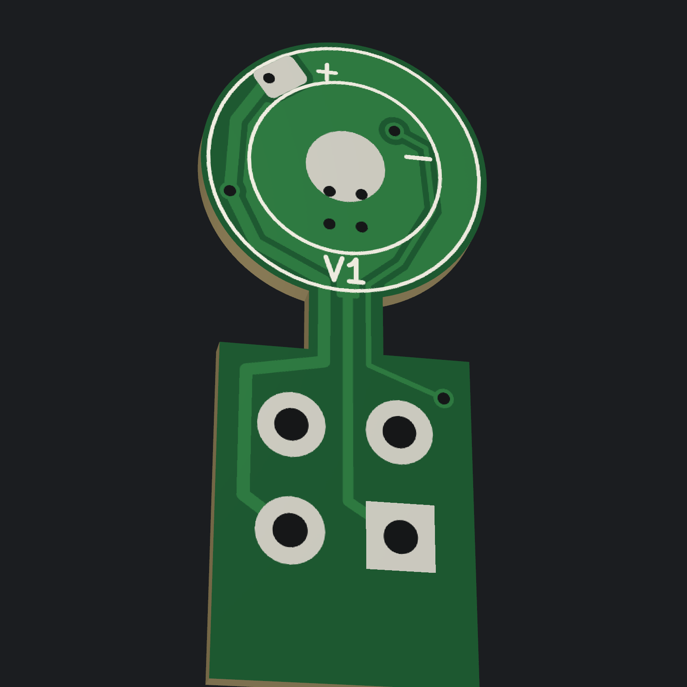

# IN100 insect tag v8.3 D1: 7.2 mm battery tag, V1 slow enable and V2 OFF jumper

An open Bluetooth LE beacon tag for insects built around the InPlay **IN100 NanoBeacon**, derived from v7.
The cell sits centred under the IN100: its − cap goes on one large pad on the underside, and one short wire runs
from a rim pad to the can. JLCPCB fits every part; you add the cell, a 31 mm antenna wire and epoxy.

**v8.1 was the compact layout:** Ø 7.2 mm instead of 8 mm plus antenna lobes, with the same parts and package sizes.
The antenna and counterpoise wires solder flat onto **edge pads** on the top side.

**v8.3 (this revision, the final test order)**:

- **0.6 mm board**, ordered on one combined panel with D2. See `../panel/README.md` for the order,
  the variant counts and the reasoning.
- **AE1 (ANT) moved to the upper-right rim** (−19°) and enlarged to 1.2 × 0.9 mm. It now has ≥ 0.75 mm to every
  other-net pad; v8.2's pad sat 0.29 mm from C4. **ANT** is printed just below it.
- **AE2 (GND)** is now a slim 0.5 × 0.9 mm pad hugging the rim at the lower left (147°), between the crystal and the
  IN100. It is 0.36 mm clear instead of 0.20 mm.
  - It is the only GND-safe spot on that side; C1's and C2's pads fill the top left.
  - There is no room for a label; it is the small pad at about 8 o'clock.
- **V2 is now 100 kΩ / 10 nF** (was 1 MΩ / 1 nF). It hedges an unpublished CHIP_EN input load (see "Variants").
- **Panel tabs:**
  - The side tabs sit at matching heights (155° / 25°). In v8.2 they met their neighbours through a 0.4 mm Z-neck.
  - The tail is held by wide tabs, whose nubs end up on the scrap tail.
- The cell pads are unchanged; there is ≥ 2.3 mm free round the + pad.

**v8.2** kept the v8.1 copper and changed values and instructions after an independent first-principles
review (`docs/independent_review.md`):

- **V1's enable is now 1 MΩ / 100 nF** instead of SparkFun's 1 kΩ / 100 nF. With a 337 (75–85 Ω), the cell charges
  C1 with a 4–20 ms time constant, and the old 0.1 ms enable let the IN100 start and transmit at ≈ 0.9 V: a brown-out
  lock (review F2, reproduced in `docs/burst_sim.txt`).
- **C1 is ≈ 55 µF at 1.5 V, not 80 µF** (review F1), so every margin below is recomputed.
- **The datasheet maximum is +4 dBm, not +5 dBm.** On a 337, program **0 dBm**: +4 dBm can lock a cold or worn 337
  for good (F4).
- **The underside − label** moved off the round pad: JLC would have clipped it.

The panel carries two population variants on identical copper:

- **V1 slow enable**: 1 MΩ / 100 nF (τ 0.1 s). CHIP_EN rises well after the cell has charged C1, so you can fit the
  cell with the tag live. This is the "should just work" unit.
- **V2 OFF jumper**: 100 kΩ / 10 nF (v8.3) with the **OFF** solder bridge on the tail. Bridge it, fit the cell,
  and the tag stays silent until you **cut the tail**.

TX power is an OTP setting, not hardware: use 0 dBm on a 337 and keep +4 dBm for 364/377 cells.

| Top | Bottom |
|---|---|
|  |  |

The top view shows the antenna edge pad on the upper-right rim (AE1, RF, **ANT** below it) and the slim counterpoise
pad at the lower left (AE2, GND). The bottom view shows the Ø 2.0 mm − pad (with **−** printed
to its left), the 337 and 364/377 cell outlines, and the + pad at the upper right. Renders: `tools/render3d.py`; flat previews: `docs/pcb_preview.png`.

## What changed from v7

| | v7 | v8 D1 | Why |
|---|---|---|---|
| Disc | Ø 7.0 mm | **Ø 7.2 mm**, no lobes (7.2 × 7.65 mm with the neck stub). v8.0 was Ø 8.0 mm, 8.6 × 8.9 mm with lobes | Same parts, tighter packing: C1 centred across the top, C2 upright in the top-left corner, CHIP_EN via between R1 and C2 |
| Bulk capacitor | 47 µF 0603 | **C1 100 µF 0805** (GRM21BR60J107ME15L) + **C4 100 nF** at VDDQ | Burst margin (≈ 55 µF effective at 1.5 V). v8.0's extra 10 µF (C3, SparkFun parity) is gone: it added only 0.01–0.03 V of margin (confirmed by the review) |
| Cell | − cap on a Ø 1.6 mm pad off-centre | **Centred on the IN100**, − cap on a **Ø 2.0 mm** solder-mask-defined GND pad; the EP vias land inside it | Biggest pad that stays inside the smallest − cap |
| Crimp keep-out | none | Underside ring r = 1.65–3.70 mm with no exposed copper | The cans' crimped edges can't touch anything but + |
| + contact | top rim pad | **0.9 × 1.2 mm underside pad** at the upper-right rim (r = 2.45–3.35 mm) with the VCC via in it, "+" on silk | A 6.8 mm can sits directly on it; for a 337 the wire runs from it to the can. The top rim has no room left for a second pad |
| CHIP_EN | underside | Top layer to R1 and C2, one tented via between them, underside round the left to the neck | The only way past the crystal at 7.2 mm |
| J1 programming pads | Ø 1.4 mm | **Ø 1.6 mm at 2.54 mm** | Easier pogo pins and hand soldering |
| Antenna | one hole | **Top-side edge pads**: AE1 (RF, 0.8 × 1.1 mm, silk **ANT**) on the right rim, 0.8 mm from RF_TX; AE2 (GND, 0.8 × 0.8 mm, silk **G**) at the lower left, 150° round from AE1 | Easier to solder than a hole near the rim; the wire lies flat and leaves over the edge |
| Parts | — | **6 parts**: IN100, crystal, 100 µF, 100 nF, and the two enable parts R1/C2 | The minimum for a clean start and the cut-to-start tail; no smaller 100 µF exists at JLC (the only 0603 one is an out-of-stock tantalum with 15 Ω ESR), and 1612 is the smallest 26 MHz crystal that meets the IN100's spec |
| Variants | A–E | **V1** and **V2** | See below |

## Variants

Same copper. The v8.3 order is the combined panel: **8 of each** on 2 assembled panels (columns 7–8 V1, 9–10 V2;
unit map in `../panel/docs/panel_units.csv`). `PANEL_COLUMNS` and `tools/make_fab.sh` here still
build the old D1-only panel.

| Variant | R1 (VCC → CHIP_EN) | C2 (CHIP_EN → GND) | Start-up | Program to | Tail silk |
|---|---|---|---|---|---|
| **V1 slow enable** | 1 MΩ (C26083) | 100 nF (C1525), τ 0.1 s | Starts ≈ 0.1 s after the cell is fitted, at full cell voltage. OFF bridge optional | 0 dBm, 3 s (+4 dBm only on 364/377) | `V1 SLOW` |
| **V2 OFF jumper** | **100 kΩ** (C25741) | **10 nF** (C15195), τ 1 ms | Bridge OFF before fitting the cell, then cut the tail to start | 0 dBm, 3 s (+4 dBm only on 364/377) | `V2 OFF` |

**Why V2 changed to 100 kΩ (v8.3).** The IN100 datasheet gives no CHIP_EN input current and doesn't say whether the
pin has an internal pull-down. A 1 MΩ pull-up only reaches the 0.6 VCC threshold if:
- any pull-down is ≥ 1.5 MΩ, or
- the input current is ≤ ≈ 0.5 µA.

If the pin turns out to load more than that, every V1 stays silent. V2's 100 kΩ copes with a pull-down down to 150 kΩ
or up to ≈ 5 µA (`docs/burst_sim.txt`, last section).
- **The price:** with OFF bridged, V2 draws 15.5 µA, so a 337 lasts ≈ 22 days bridged (V1: 1.6 µA, ≈ 7 months).
  Fit a V2's cell close to when you cut its tail.
- **If V1 works**, swap a V2's R1/C2 to 1 MΩ/100 nF and it becomes a V1. Both are 0402s on the same copper.
- **If V1 doesn't start on the bench**, swap its R1 to 100 kΩ (C2 can stay; use OFF).

**D1-a: power-up order.** The IN100 datasheet (§5.2, power-up figure) wants VCC at its final value before, or with,
CHIP_EN. v8.1 argued that SparkFun's 1 k × 100 nF (0.1 ms) lags VCC enough. **The review showed it doesn't on a
337:** the cell (75–250 Ω) charges C1 (45–55 µF) with a 4–14 ms time constant, so CHIP_EN passes 0.6·VCC while VCC
is still under 1 V. The IN100 then starts its first advert there and locks (it needs VCC < 0.1 V to restart).
`docs/burst_sim.txt`, power-up section:

| Enable | Cell | Starts at | VCC then | Lowest VCC in the first advert |
|---|---|---|---|---|
| v8.1 V1, 1 k / 100 nF | 80–250 Ω, 45–55 µF | 3–12 ms | ≈ 0.9 V (power-on reset, assumed) | 0.71–0.90 V: **locked** |
| **v8.2 V1, 1 M / 100 nF** | 80–250 Ω, 45–55 µF | 95–106 ms | 1.55 V | **1.22–1.32 V** |
| v8.2 V2 with OFF bridged, then the tail cut | any | when cut | 1.55 V | as in the burst table |

Don't fit a cell to a V2 with OFF open: with 1 nF it races the cell exactly like the old V1.

With OFF bridged, R1 draws 1.56 µA on V1 (about 14 % of a 337 per month) and 15.5 µA on V2.

**CHIP_EN above VCC:** the datasheet's absolute maximum for CHIP_EN is −0.3 V to VCC. During each advert, C1 sags by
up to 0.3 V while C2 holds CHIP_EN for a moment: about 10 ms on V1, about 1 ms on V2. The review rates this
"almost certainly benign", because the pin's ESD diode doesn't conduct below ≈ 0.4 V. Don't add a clamp diode: its
leakage would hold CHIP_EN up.

## Burst simulation (D1-b)

`tools/burst_sim.py` (output in `docs/burst_sim.txt`).

**Model:**

- Cell: EMF behind its internal resistance.
- C1: **55 µF effective** at 1.5 V, 45 µF worst case. Murata's own model gives 72 µF at 0 V before DC bias; then
  DC bias, −20 % tolerance, cold and ageing (review F1). v8.1 assumed 80 µF.
- Event: 0.8 ms crystal start at 1.5 mA, then 3 channels × (0.5 ms TX + 0.15 ms gap).
- The IN100 needs **VCC ≥ 1.1 V**; below that it has to fall under 0.1 V before it restarts.

Lowest VCC during one advertising event:

| C1 effective, TX | fresh, 20 °C (80 Ω) | cold or half used (150 Ω) | end of life (250 Ω) | cold end of life (400 Ω) |
|---|---|---|---|---|
| **55 µF, 0 dBm (9.1 mA)** | **1.32 V** | **1.27 V** | **1.23 V** | **1.20 V** |
| 45 µF, 0 dBm | 1.28 V | 1.22 V | 1.17 V | 1.14 V |
| 55 µF, +4 dBm (13.8 mA, the datasheet maximum) | 1.21 V | 1.16 V | 1.11 V | **1.08 V** |
| 45 µF, +4 dBm | 1.16 V | **1.09 V** | **1.03 V** | **0.99 V** |
| 55 µF, 0 dBm, if TX draws 1.5 × the 3 V figure at 1.5 V | 1.22 V | 1.16 V | 1.11 V | 1.08 V |
| v8.1's 80 µF assumption, 0 dBm / +4 dBm | 1.38 / 1.30 V | 1.35 / 1.26 V | 1.31 / 1.23 V | 1.28 / 1.20 V |

- **At 0 dBm a 337 keeps ≥ 0.04 V of margin even in the worst case.**
- **At +4 dBm a cold or worn 337 drops under 1.1 V.** After the tail is cut nothing can take VCC under 0.1 V, so that
  lock is permanent. Use 0 dBm on 337s.
- +4 dBm is fine on 364/377 cells (5–15 Ω): ≥ 1.38 V even at 45 µF (1.24 V if a cold, worn one reaches 40 Ω).
- The ×1.5 row covers a higher TX draw at 1.5 V. The review thinks it unlikely, because the radio runs from an
  on-chip 1.2 V regulator.
- The bench test in "Bring-up" measures the real dip.

Charge per advertising event at 0 dBm: 16.2 µC; InPlay's own PV-kit figures imply ≈ 13 µC (review C). Average
current at a 3 s interval: 6.0 µA.

## Cells

The cell goes on the **underside** with its **− cap facing the board**. The wire then goes to the can, which is
already + potential, so a stray wire touching the can's side can't short anything.

- **− pad:** Ø 2.0 mm solder-mask opening on a Ø 2.6 mm GND copper disc, centred under the IN100. It stays inside
  the smallest − cap of the supported cells, so silver epoxy on it can't reach the can's crimp.
- **Crimp keep-out:** an underside ring from r = 1.65 mm (smallest − cap radius + 0.2 mm) to r = 3.70 mm
  (6.8 mm can radius + 0.3 mm) carries no exposed copper. It is drawn on B.Fab; the 4.8 mm and 6.8 mm cell outlines
  are on B.SilkS. VCC copper inside the ring is harmless (it's the can's own potential).
  **Three tented vias sit just inside the ring's inner edge, all at r = 1.70 mm:** the IN100's two lower exposed-pad
  vias (GND) and the CHIP_EN via (between R1 and C2 on the top). Solder mask covers them. On a 337, r = 1.70 mm
  should fall on the sealing gasket between the − cap and the crimp; on the 6.8 mm cells it is under the flat
  − cap (GND). The underside also carries the CHIP_EN and VCC tracks and the GND pour, all under solder mask.
  If the mask over the EN via were ever breached, the cell would pull CHIP_EN to GND or VCC, so stick a
  **Kapton washer** (≈ Ø 7 mm, Ø 2 mm hole) on the underside before fitting the cell; it covers all three vias.
- **+ pad:** 0.9 × 1.2 mm on the underside at the upper-right rim (r = 2.45–3.35 mm), outside the 337 outline,
  with the VCC via in it. A 6.8 mm can sits directly on it (both are +); for a 337 the + wire runs from it to the can.

| Cell | Size (mm) | Cell mass | Tag total (no epoxy) | Height | Life at 3 s, 0 dBm (to empty) |
|---|---|---|---|---|---|
| **337** silver oxide (lightest) | 4.8 × 1.65 | 0.13 g | ≈ 0.26 g | ≈ 3.8 mm | ≈ 57 days (8.3 mAh) |
| 364/363 silver oxide | 6.8 × 2.15 | 0.37 g | ≈ 0.50 g | ≈ 4.3 mm | ≈ 159 days (23 mAh) |
| **377/376** silver oxide (longest life) | 6.8 × 2.6 | 0.42 g | ≈ 0.55 g | ≈ 4.7 mm | ≈ 187 days (27 mAh) |

Cell figures are Energizer's. A 337 is 75–85 Ω and is marked obsolete by Energizer, so source Renata or Maxell
SR416SW. Lives ignore self-discharge and assume the whole capacity is usable. A low-drain silver-oxide cell's last part
may not deliver the burst, so plan on about half. +4 dBm costs roughly 1.4× the charge per event.

The cell never supplies the 9–14 mA burst itself. C1 does, and the cell refills it at ≤ 3 mA, decaying over
4–14 ms.
Buy **SR** (silver oxide), not LR/AG (alkaline): the alkaline versions sag toward 1.1 V long before they're empty.

## Mass and size

Finished tag (tail cut): **Ø 7.2 mm disc, 7.2 × 7.65 mm with the neck stub**, board area 41.6 mm²
(v8.0: 8.6 × 8.9 mm, 57.6 mm²). The 6.8 mm cells now cover almost the whole disc.

| | 0.8 mm board (v8.2) | **0.6 mm board (v8.3 order)** |
|---|---|---|
| Bare board after the cut (FR4 + 2 × 35 µm copper, mask) | ≈ 73–81 mg | ≈ 58–65 mg |
| Parts and solder (C1 23 mg, IN100 ≈ 19, crystal 3, three 0402, solder 5–8) | ≈ 53–57 mg | ≈ 53–57 mg |
| **Tag without cell** | ≈ 0.13 g | **≈ 0.12 g** (≈ 0.25 g with a 337) |

**Why not smaller:** the 0805 C1 sets the width of the top of the disc (its corners sit 0.2 mm from the edge), and the
IN100, the 0402 row above it and C1 fill the height. Ø 7.0 mm would need a 0603 100 µF, and JLC has none in its
assembly library (checked for v8.0); a 47 µF 0603 as on v7 fits but halves the burst reservoir.

These are estimates: the review's method with board copper, Murata's mass for C1 and TXC's for the crystal; the
IN100 is estimated. Weigh the first tags.

The route to a smaller Irulu (flex, a 47 µF 0603 C1, then a WLCSP IN100 on a board no bigger than the 337) is in
[`../docs/roadmap.md`](../docs/roadmap.md).

## Circuit

- **U1** IN100-Q1-R-RC1I (QFN18, C6062024). VCC and VDDQ tied to the cell. UART on GPIO0 (RXD) and GPIO1 (TXD).
  Other GPIOs, load switches and RTC pins open. Four vias in the exposed pad.
- **Y1** TXC 8Q26000008 (C5203638): 26 MHz, 7 pF, 80 Ω, ±16 ppm, on the IN100's internal load capacitors
  (spec: CL 6–8 pF, ESR 60–100 Ω, ±40 ppm). No load capacitors, as on SparkFun's boards.
- **C1** 100 µF 6.3 V X5R 0805 (C141660), **C4** 100 nF 0402 (C1525) at VDDQ (pin 13).
- **R1 / C2** enable network (variant values above). **JP1 "OFF"** on the tail ties CHIP_EN to GND.
- **AE1** RF_TX to a top-side edge pad on the upper-right rim (v8.3), ≈ 1.2 mm of 0.25 mm track (the IN100 has its
  50 Ω match on chip; SparkFun uses no external match). **AE2** a slim edge pad on GND at the lower left for a
  counterpoise / second dipole arm.
- **BT1** the cell interface above. **J1** on the tail: **R** = RXD (into the IN100), **T** = TXD, **G** = GND, **+** = VCC.

Schematic: `docs/schematic.pdf`.

## What's in the folder

| Path | What it is |
|---|---|
| `insect_tag_v8_battery.kicad_pro/.kicad_sch/.kicad_pcb` | KiCad project with V1's values (KiCad 7 format) |
| `insect_tag.kicad_sym`, `insect_tag.pretty/`, `insect_tag.3dshapes/` | Symbols, footprints and 3D models |
| `fab/jlcpcb_panel/` | Economic-assembly panel (0.8 mm, 90.0 × 49.0 mm): Gerbers zip, BOM, CPL |
| `fab/insect_tag_v8_battery_panel.kicad_pcb` | The panel with per-unit variant values |
| `fab/jlcpcb_single/` | Gerbers for one tag with its tail (bare boards) |
| `docs/` | Renders, previews, panel image, schematic PDF, DRC reports, variant map, burst simulation |
| `tools/` | Generators and checks (see Rebuilding) |

## Ordering from JLCPCB

**v8.3: order the combined 0.6 mm panel, as described in `../panel/README.md`.** The rest of this
section describes v8.2's separate 0.8 mm D1 panel and is kept for reference only. Its rebuilt panel in
`fab/jlcpcb_panel/` is below Standard PCBA's 70 × 70 mm minimum, so don't order it.

1. Upload `fab/jlcpcb_panel/insect_tag_v8_battery_panel_gerbers.zip`. 2 layers, **0.8 mm**, lead-free HASL,
   green. Delivery format **Panel by Customer** (rails, tooling holes and fiducials are in the Gerbers).
   "Mark on PCB": specify location (bottom rail, `JLCJLCJLCJLC`).
2. PCB Assembly: **Economic**, top side. Upload the BOM and CPL from the same folder. Each placement has its own
   designator (`R1_V2_3` = R1 on the third V2 tag). Three parts are extended (IN100, crystal, C1); the rest are Basic.
3. **Assemble 2 of the 5 panels**: 40 tags, 20 V1 + 20 V2, 40 IN100s.
4. In the placement preview check pin 1 of **U1** and the orientation of **Y1** against the silkscreen dots.
   Fix any offset in the CPL, not the footprints.

### Stock on 2 Nov 2026

| Part | LCSC | Stock | Note |
|---|---|---|---|
| IN100-Q1-R-RC1I | C6062024 | 753 (LCSC) | 40 per D1 order (80 if D2 is ordered too). Dropped from InPlay's V2.4 datasheet (June 2026): buy spares now |
| 26 MHz crystal 8Q26000008 | C5203638 | 1,310 (LCSC) | |
| 100 µF 0805 GRM21BR60J107ME15L | C141660 | **27,104 in JLC's assembly library, but only 15 at LCSC** | Confirm in the JLC cart. Fallback: CCTC TCC0805X5R107M6R3FT, **C49215609** (100 µF 6.3 V X5R 0805, 5,258 in JLC's library); its DC-bias derating is unknown, so re-check the burst margin |
| 100 nF, 1 nF, 1 M (0402) | C1525, C1523, C26083 | Basic, millions | |

Check every line again on order day.

## Hand assembly

1. **Break a tag out of the panel.** Snap the tabs and sand the nubs. **Leave the tail on.**
2. **Program it first** (see below), with no cell fitted and JP1 open.
3. **V2: bridge JP1 "OFF"** with a blob of solder (optional on V1, which starts slowly anyway). Power the tail's +
   and G from the adapter: the tag must stay silent.
4. **Antenna (RF wire):**
   - Use the **AE1** edge pad on the **upper-right rim** (1.2 × 0.9 mm, silk **ANT** just below it). The paste
     stencil already leaves solder on it.
   - Lay a straight ~31 mm wire (λ/4 at 2.44 GHz in air; ~0.1 mm enamelled copper, end scraped and tinned) flat
     along it so it leaves over the edge, and reflow.
   - Trim while watching RSSI. That alone is a working monopole.

   **For a dipole**, add a second 31 mm wire on **AE2**, the slim GND pad on the **lower-left rim** (about 8 o'clock,
   between the crystal and the IN100's lowest left pins):
   - Use a fine tip and little solder; it has 0.36 mm of clearance.
   - Bend the wire to leave opposite AE1.
   - Do this whenever radiated power matters (e.g. Hubble later).
   - Never connect the two wires together.
   On the underside, **−** marks the round pad for the cell's − cap and **+** the rim pad for the can.
5. **Fit the cell** (− cap towards the board):
   1. Optional Kapton washer on the underside, its hole over the gold − pad.
   2. Put a **small** dab of silver-filled conductive epoxy on the − pad and seat the cell, centred on the
      B.SilkS ring. Epoxy that bridges the cap and the can shorts the cell.
   3. Solder a short wire (0.2 mm tinned copper or 0.1 mm nickel strip) to the underside **+** pad before seating
      the cell (a 6.8 mm can sits directly on the pad; still add the wire or a dab of epoxy for a reliable contact).
   4. Bend the wire to the can's side wall and fix it with silver epoxy. **Never solder to the cell.**
   5. Cure, then encapsulate with ordinary epoxy, leaving the antenna free beyond the first millimetre.
6. **Check:** the tail's + and G pads read the cell voltage. V1 (OFF open) should now be advertising; V2 should be
   silent.
7. **V2 in the field:**
   - Cut the neck at **CUT** by scoring both faces with a scalpel and snapping (or filing). **Don't use side
     cutters:** the cell is live and they can smear VCC onto GND.
   - Check the tag on a phone scanner.
   - Seal the cut edge with a dot of epoxy (the CHIP_EN stub runs through the neck).
   - The underside carries **V1** or **V2** between the cell outlines, so the variant stays readable before the cell
     goes on.

## Programming (OTP: Find My or Hubble)

Wire a 3.3 V USB-UART adapter to the tail: **T** → adapter RX, **R** → adapter TX, **G** → GND, **+** → 3.3 V.
Use InPlay's NanoBeacon Config Tool. VDDQ needs 3.3 V ± 10 %, up to 50 mA, to burn the OTP: use a supply good for
≥ 100 mA (an FT232R's 3V3OUT is too weak). Apply + and G before R/T, or put 1–4.7 kΩ in series with the adapter's TX,
so the UART can't back-power the IN100. **Never connect the programmer once a cell is fitted**: it would drive 3.3 V
into the cell. V1's 100 ms enable delays start-up by 0.1 s after power: let it settle before probing.

- Load the configuration into RAM and check it with a phone scanner first. **The OTP can be written only once.**
- **Both variants on a 337:** 0 dBm, 1 Mbps PHY, 3 s interval. **+4 dBm (the maximum) only with a 364/377 cell**,
  or on a single advertising channel (≈ 8 µC per event).
- Set **XO load capacitance ≈ 6–6.5 pF** (the crystal is 7 pF; the extra allows for strays) and check the frequency
  offset on two or three tags.
- *Find My* (default for the first units, OpenHaystack static key): non-connectable advertising with the payload
  `1E FF 4C 00 12 19 00 <key bytes 6–27> <key[0] >> 6> 00`; static random address `key[0] | 0xC0, key[1..5]`.
- *Hubble:* see [programming](../docs/programming.md#network-payloads) (`new_hubble_tag.py`; don't use the Config
  Tool's own Hubble format). No hardware change is needed.

## Bring-up

1. **Bench:** power from a **1.45 V bench supply through a 150 Ω series resistor** (stands in for the cell's
   internal resistance) on + and G.
   - Load a 0 dBm configuration into RAM (and +4 dBm on one tag). Check the adverts in nRF Connect.
   - Scope + and G during an advert and compare the dip with the table above: ≈ 1.27 V at 0 dBm and ≈ 1.16 V at
     +4 dBm with 150 Ω and 55 µF. The dip also tells you C1's real value.
   - Measure the average current with a Nordic PPK2 or µCurrent (expect ≈ 6 µA at 0 dBm, 3 s).
   - V2: bridge OFF and measure the off current (≈ 15.5 µA with v8.3's 100 kΩ), then remove the bridge with wick: it
     must start.
   - **CHIP_EN load test (do this first, on one V1 and one V2).** With 1.5 V on + and G and OFF open, measure the
     left OFF pad (EN) to G with a 10 MΩ meter. Expect ≈ 0.91 × VCC on V1 and ≈ 0.99 × VCC on V2 (the meter loads
     it).
     - A clearly lower reading means the IN100 has an internal pull-down.
     - Below 0.6 × VCC on V1, use V2's 100 kΩ (or less) on every battery tag.
2. Then fit a real **337** and a real **377** and repeat the dip and range checks (monopole vs dipole RSSI at a fixed
   distance).

## Checks done

- **KiCad 7 (build container), v8.2:** board DRC 0 violations, 0 unconnected; netlist matches the design; no pour islands;
  panel DRC 0 violations, 0 unconnected. JLC rules throughout: ≥ 0.127 mm tracks and gaps, 0.3 mm vias,
  copper ≥ 0.2 mm from the edge, and hole-to-copper ≥ 0.2 mm, so the mouse bites keep ≥ 0.2 mm from the pour
  (KiKit refills the zones after drilling them). Reports: `docs/drc_report.txt`,
  `docs/insect_tag_v8_battery_panel_drc.txt`.
- Part bodies checked for physical clearance (≥ 0.32 mm between body outlines; no courtyard overlaps). Silk text
  clear of every pad (`silkcheck`; v8.1's underside − sat on the round pad and was moved).
- **Independent first-principles review** of both tags (`docs/independent_review.md`, scripts in
  `docs/review_scripts/`). No blocker in copper, pinouts or polarities; its value and setting findings are applied
  above.
- **v8.3:** board DRC 0/0 and netlist parity again after moving AE1/AE2. The combined panel's checks are in
  `../panel/README.md`.
- **KiCad 10.0.7 (Mac, 6 Nov 2026):** DRC 0 errors, 0 unconnected, 1 cosmetic warning (BT1's reference text on
  B.Fab). ERC 0 errors; three library-version warnings (Crystal_GND24, SolderJumper_2_Open, Battery_Cell).

## Rebuilding

- `tools/design.py`: parts, nets, outline, placement, every track and via, variants and the panel column map.
- `tools/gen_footprints.py` writes footprints and 3D models; `tools/build.py` writes the KiCad files and refills the
  pours with the project's rules; `tools/check.py` runs DRC, netlist parity, the island check and the crimp-ring check.
- `tools/render.py` (flat preview), `tools/render3d.py` (3D renders), `tools/panel_preview.py` (panel image).
- `tools/run_all.sh` runs the board steps; `tools/make_fab.sh` panelizes with KiKit 1.6.0, then runs
  `tools/variants.py` (per-variant values, tail labels, BOM, CPL, `docs/panel_variants.csv`) and writes the Gerbers.
  Build container: `KIKIT="python3.12 -m kikit.ui" PY=python3.12 bash tools/make_fab.sh`.

## License

CC BY 4.0 for the hardware and documentation; MIT for the scripts. See [the licence section](../README.md#licence). No warranty: you build and use these at your own risk.
No warranty: you build and use these at your own risk.
