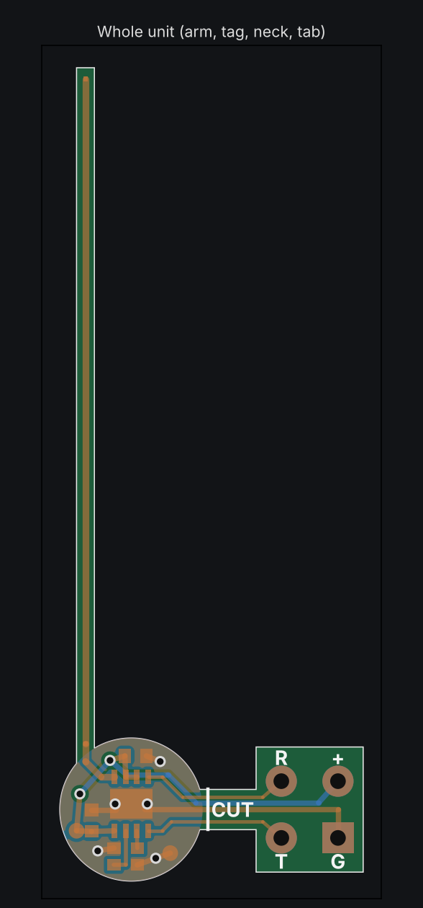

# IN100 insect tag v4 (6.4 mm round, printed antenna arm)

This is an open, Blu Bat-style Bluetooth LE beacon tag built around the InPlay **IN100 NanoBeacon**.
It's a round 6.4 mm tag with the antenna printed on a 30 mm FR-4 arm. A programming tab hangs off a neck, and you cut the neck once the tag is programmed.
You choose **Hubble** or Apple **Find My** (OpenHaystack-style keys) when you burn the IN100's OTP.
JLCPCB fits all four parts: the IN100, a crystal and two capacitors. You add the 337 cell and epoxy.

| | v4 (this) | Blu Bat (for reference) | v2 |
|---|---|---|---|
| Tag | **6.4 mm round**, 0.6 mm board | 5.0 mm round | 5.8 × 5.5 mm |
| Total length incl. antenna | 36.4 mm (tag bottom to arm tip) | 37.5 mm | tag + loose wire |
| Antenna | 29.75 mm trace on a 0.8 mm FR-4 arm | PCB arm | ~31 mm wire you fit |
| Parts JLC fits | IN100, 26 MHz 1612 crystal, 100 nF, 10 µF (all 0402 or smaller except the IN100) | – | IN100, 2016 crystal, 100 nF, 47 µF 0603 |
| Rules | JLC standard: ≥ 0.13 mm track and gap, 0.3 mm vias | – | 0.1 mm rules |
| Mass (estimate) | ≈ 0.1 g board + parts, ≈ 0.23 g with a 337 cell | 0.21 g | ≈ 0.06 g + wire |
| Panel | 2 × 6 = 12 tags, 92 × 89 mm | – | 66 tags |

Why 6.4 mm and not 5.0: at 5 mm the IN100's 2.5 mm package leaves no room to route its pins with standard rules. 6.4 mm fits everything at JLC's standard rules with no via-in-pad, no 0201 parts and no fine-pitch tricks, so fabrication stays cheap and the parts are standard.

## What's in the folder

| Path | What it is |
|---|---|
| `insect_tag.kicad_pro`, `.kicad_sch`, `.kicad_pcb` | KiCad project (KiCad 7 format; KiCad 8, 9 and 10 open it) |
| `insect_tag.kicad_sym`, `insect_tag.pretty/` | IN100 symbol and the custom footprints |
| `fab/jlcpcb_panel/` | **What you upload to JLCPCB**: Gerbers zip, `insect_tag_panel_bom.csv`, `insect_tag_panel_pos.csv` |
| `fab/jlcpcb_single/` | Gerbers for one unit (arm + tag + tab), for bare boards and hand assembly |
| `docs/` | Schematic PDF, board renders (`pcb_preview.png`, `pcb_preview_unit.png`), panel render, DRC report |
| `tools/` | Python generators (`design.py` holds every placement and track), KiKit panel config, `make_fab.sh` |

## Circuit

- **U1 IN100** runs straight off the cell (1.1–3.6 V). CHIP_EN, VCC and VDDQ are tied together.
- **Y1** TXC 8Q26000008: 26 MHz, 7 pF, ±16 ppm, 1.6 × 1.2 mm (LCSC C5203638). The IN100's on-chip load capacitors replace external ones.
- **C1** 100 nF (C1525) sits right at the VCC/VDDQ pins. **C2** 10 µF 6.3 V (C15525) is bulk storage for the TX bursts, which the tiny 337 cell can't supply alone. Both are JLC basic parts.
- **AE1** is the antenna: a 0.25 mm trace running 29.75 mm up the arm, fed straight from RF_TX. A ground pour on both layers of the round tag acts as the counterpoise.
- **BT1** has two top-side rim pads for the cell's welded tabs: **+ on the left**, **− at the lower right**.
- **J1** is on the cut-off tab: **R** = RXD (into the IN100), **T** = TXD (out of the IN100), **+** = VCC, **G** = GND, on a 2 × 2, 2.54 mm grid.

Layers: the top carries the parts and signals. The bottom is a ground plane with the VCC traces, and it sits against the cell, so you **need a Kapton disc between the board and the cell**.
The neck carries RXD, GND and TXD on top and VCC alone on the bottom. A copper burr from cutting can't easily short the supply.

## Ordering from JLCPCB

1. Upload `fab/jlcpcb_panel/insect_tag_panel_gerbers.zip`. Options:
   - 2 layers, **0.6 mm** thickness, ENIG recommended.
   - Delivery format **Panel by Customer**. The rails, tooling holes and fiducials are in the Gerbers.
   - For "Mark on PCB", specify the location: the bottom rail carries a `JLCJLCJLCJLC` marker.
   - JLC may ask about the long 0.8 mm arms. They are intended: each arm is tabbed to a rail at its tip.
2. Turn on PCB Assembly, top side. Upload the BOM and CPL from the same folder.
   - Y1 is a JLC **extended** part. C1 and C2 are basic.
   - **U1 has no LCSC number.** Pick `IN100-D1-R-YC1I` in Global Sourcing, or consign parts you buy yourself (Mouser 73-IN100-D1-R-YC1I).
3. In the placement preview, check that the pin-1 marks on **U1** and **Y1** match the silkscreen dots. Rotate in the JLC tool if their 3D model is off.

The panel puts every second row upside down. Each tag is tabbed to the programming tab of the tag opposite it, and each arm tip to a rail.

## Bringing up a tag

**Program first, fit the cell last. Never connect the programmer while a cell is fitted.**

1. **Break a unit out of the panel.** Snap the arm-tip tab and the tabs around the tag and programming tab, and sand the nubs. Leave the neck intact.
2. **Wire a 3.3 V USB-UART adapter** to the tab's pads, using a pogo jig, a 2 × 2 header or tacked wires:
   - **T** → adapter RX
   - **R** → adapter TX
   - **G** → GND
   - **+** → 3.3 V

   Use 3.3 V because VDDQ needs it (up to 50 mA) while the OTP is burned.
3. **Program with InPlay's NanoBeacon Config Tool.** Load the configuration into RAM first and check it with a phone scanner, then burn the OTP. **The OTP can be written only once.**
   - *Hubble:* follow Hubble's IN100 guide (AES-128-EAX with the device-uptime counter).
   - *Find My (OpenHaystack-style):* non-connectable advertising with the payload `1E FF 4C 00 12 19 00 <key bytes 6–27> <key[0] >> 6> 00`.
     The static random address is `key[0] | 0xC0, key[1..5]`, at a 1–2 s interval. A slower interval saves the cell.
4. **Cut the neck** at the silkscreen line, flush to the tag, with sharp flush cutters. Sand the stub.
5. **Check for shorts:** measure across the + and − rim pads. You should see the 10 µF charging, not a dead short.
6. **Fit the cell.** Use a 337 (SR416SW) with welded tabs, or have 0.1 mm nickel strip spot-welded on.
   - Put a Kapton disc on the board's underside and the cell on that.
   - Bring the + tab up the left edge onto **+** and the − tab up the lower-right edge onto **−**, then solder them.
   - Keep Kapton between the − tab and the can wall. Never solder directly to the cell.
7. **Coat** the tag, the cell and the arm root in a thin layer of epoxy. Leave the arm itself bare or lightly coated.

## Antenna notes

The antenna trace is an untuned quarter-wave monopole working against a 6.4 mm ground. Expect less range than a dev board.
Trimming the arm shortens the trace and raises its resonant frequency. Coating it in epoxy lowers it.
To tune it, compare RSSI at a fixed distance as you trim, a millimetre at a time.
If a stiff FR-4 arm doesn't suit the animal, snap the arm off at the tag edge and solder a fine enamelled wire, about 30 mm long, to the exposed trace end.

## Checks done

- **KiCad 7.0 DRC** (the build tools): 0 violations, 0 unconnected, board netlist matches the design.
- **KiCad 10.0.7 DRC** (after a zone refill): 0 errors, 0 warnings, 0 schematic-parity issues.
  **KiCad 10.0.7 ERC**: 0 errors. There are 2 warnings saying the embedded crystal and battery symbols differ from KiCad 10's library copies; that's cosmetic.
- Every gap is at least 0.15 mm except the IN100's own pad pitch. Copper is at least 0.2 mm from the board edge.

## Before you order a batch

- **Crystal land pattern:** the 1612 pads (0.6 × 0.5 mm on a 1.05 × 0.75 mm grid) come from the NDK NX1612SA terminal layout.
  TXC's 8Q drawing should match, but compare it with the 8Q26000008 datasheet before ordering.
- **RF:** nothing here has been tested on air yet. **Order one panel and bring up one tag end to end before you order more.**
- **Thickness:** a 0.4 mm board saves about 20 mg. JLC treats 0.4 mm boards as special (no HASL, manual review), so 0.6 mm is the default here.

## Rebuilding

- `tools/design.py` holds the parts, nets, outline, placement and every track and via. `tools/gen_footprints.py` writes the footprints.
- `tools/build.py` writes the KiCad schematic, board and rules, and `tools/check.py` runs DRC and a board-versus-netlist check. `tools/render.py` draws the previews.
- `tools/make_fab.sh` rebuilds the panel and JLC files and needs [KiKit](https://github.com/yaqwsx/KiKit).

## License

CC BY-SA 4.0. SparkFun's NanoBeacon board (CC BY-SA 4.0) and InPlay's IN100 datasheet were the references for the IN100 circuit.
No warranty: you build and use these at your own risk.
