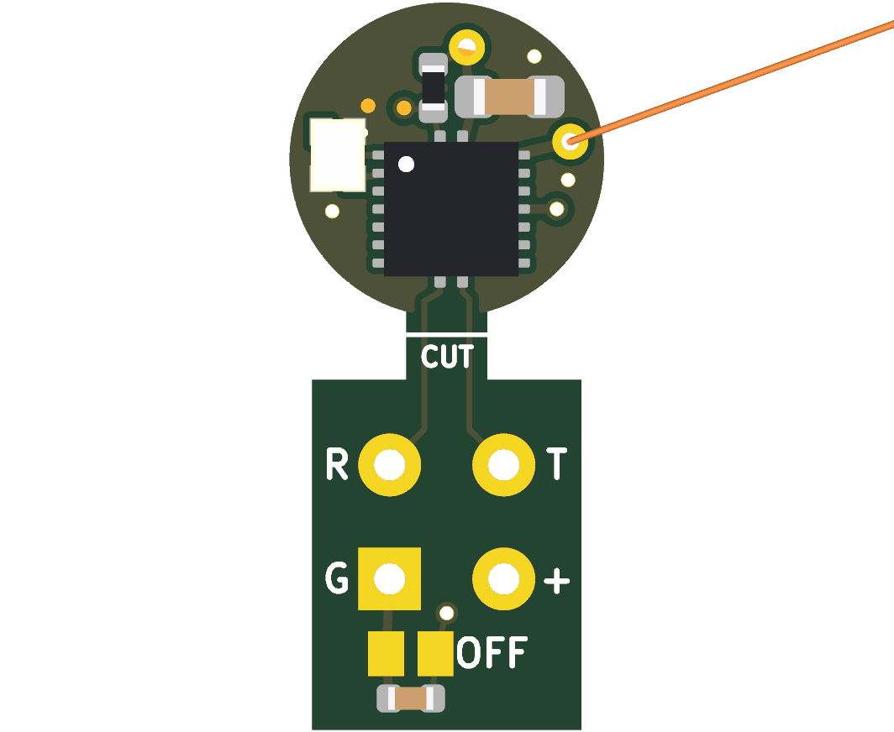

# IN100 insect tag v7: 7 mm round tag, cut-to-start tail, any button cell, five test variants

This is an open Bluetooth LE beacon tag for insects, built around the InPlay **IN100 NanoBeacon**.
You choose **Hubble** or Apple **Find My** (OpenHaystack-style keys) when you burn the IN100's OTP.
JLCPCB fits every part. You add a button cell underneath, a 30 mm wire and epoxy.

The tag works like a Blu Bat tag. It ships with a tail that carries the programming pads and an **OFF** solder jumper. Once you've bridged the jumper and fitted the cell, the tag stays off. **Cutting the tail starts it.**

v7 is a **test panel**. All 20 tags share the same copper, and five population variants sit in column pairs. One order tells you which choices work before you order a batch.

> **Do not order v6.** Checking it against SparkFun's design and the panel DRC turned up three problems, all fixed here:
> - **No small decoupling capacitor at the VCC pin.** SparkFun uses 100 nF + 10 µF. v6 had only the 47 µF.
> - **Ground copper out to the board edge.** The build script filled the pours before the 0.2 mm edge-clearance rule existed, so the saved fill reached the outline, and that fill is what the Gerbers use.
> - **Break-tab holes cutting into the ground pour.** KiKit didn't refill the pours after drilling the mouse bites.
>
> v6 also had only two vias under the IN100's centre pad. The datasheet asks for at least four.

## How v7 compares with SparkFun's IN100 boards

I parsed SparkFun's NanoBeacon and NanoBeacon Lite schematics and footprints (Eagle source, CC BY-SA 4.0) and compared them part by part.

| | SparkFun NanoBeacon (Lite) | v7 | Why the difference |
|---|---|---|---|
| IN100 footprint | QFN18, 0.4/0.5 mm pitch, 1.5 × 1.7 mm EP | Same pin map pad for pad | – |
| VCC / VDDQ | Tied together | Tied together | – |
| Decoupling | 100 nF + 10 µF 0402 | **C4** 100 nF (22 µF in B/E) + **C1** 47 µF 0603 | A 1.55 V button cell has ~80 Ω internal resistance, so the TX bursts come from C1 |
| CHIP_EN | 1 kΩ to VCC, 100 nF to GND (+ reset button on the Lite) | R1 1 MΩ, C2 10 nF, plus the OFF jumper on the tail | The pull-up current flows whenever the jumper holds the tag off. The variants test the value |
| 26 MHz crystal | 3.2 × 2.5 mm, no load capacitors | TXC 8Q26000008, 1.6 × 1.2 mm, 7 pF, 80 Ω, ±16 ppm, no load capacitors | Size. IN100 spec: CL 6–8 pF, ESR ≤ 100 Ω, ±40 ppm |
| 32 kHz crystal | None | None | The internal RC is calibrated against the 26 MHz crystal |
| RF | Direct from RF_TX to a 15 mm trace antenna, no match | Direct from RF_TX to a 30 mm wire, no match | The IN100 has its 50 Ω match on chip |
| Vias in the EP | – | 4 | Datasheet Sec. 7.6: at least four |
| Battery | CR1225 (3 V) | Any 1.4–1.55 V button cell (table below) | Mass |

## The five variants

The copper is identical on every tag; only the parts fitted differ. Each variant fills two columns on both rows, so you get **4 tags of each per panel**. The variant letter is printed on the tail.

| Variant | C4 | R1 (EN pull-up) | C2 (EN delay) | What it tests |
|---|---|---|---|---|
| **A** Baseline | 100 nF | 1 MΩ | 10 nF | The design as intended |
| **B** More bulk | **22 µF** | 1 MΩ | 10 nF | About 69 µF in total. This gives margin if the TX current at 1.5 V is higher than the datasheet's 3 V figure, or at +5 dBm |
| **C** Strong enable | 100 nF | **100 kΩ** | **100 nF** | Closer to SparkFun's enable circuit. Shows whether a 1 MΩ pull-up is too weak |
| **D** Low storage drain | 100 nF | **10 MΩ** | 10 nF | 0.16 µA while switched off instead of 1.6 µA. Shows whether CHIP_EN starts reliably through 10 MΩ |
| **E** Belt and braces | **22 µF** | **100 kΩ** | **100 nF** | B and C together. This is the variant most likely to work if anything is marginal |

Simulated lowest supply voltage during an advertising event (`tools/burst_sim.py`; the IN100 needs ≥ 1.1 V):

| | Fresh 337 (80 Ω) | Cold or half used (150 Ω) | Nearly flat (250 Ω) |
|---|---|---|---|
| A, C, D at 0 dBm | 1.25 V | 1.18 V | 1.12 V |
| B, E at 0 dBm | 1.31 V | 1.26 V | 1.22 V |
| A, C, D at +5 dBm | 1.11 V | 1.02 V ✗ | 0.95 V ✗ |
| B, E at +5 dBm | 1.20 V | 1.15 V | 1.10 V |

Current through the pull-up while the OFF jumper is bridged:

| R1 | Variants | Current | Share of a 337 per month |
|---|---|---|---|
| 1 MΩ | A, B | 1.6 µA | 14 % |
| 100 kΩ | C, E | 15.5 µA | more than the whole cell |
| 10 MΩ | D | 0.16 µA | 1 % |

So on C and E, bridge the jumper only just before deployment.

D is a bench test, not yet a field recommendation. Under the IN100 the CHIP_EN pad sits 0.2 mm from the ground pad, and a little flux residue plus humidity can leak between them.
- With **1 MΩ**, a stray 10 MΩ path still leaves CHIP_EN at 91 % of VCC.
- With **10 MΩ**, the same path would halve it.

Use 10 MΩ in the field only if D tags keep starting reliably after a night in a humid box.

### A test plan

You can program every tag into RAM for these tests and burn the OTP only on the tags that go into the field.

1. **Start-up.** Fit a cell with the OFF jumper bridged, then remove the bridge with solder wick. The tag should start advertising, and you can repeat this as often as you like without cutting the tail. Do it 10 times on A, C and D. If D always starts, use 10 MΩ from then on.
2. **Supply dip.** Put a scope on the tail's **+** and **G** pads while the tag advertises from a 337, at room temperature and straight out of a fridge. Compare A with B at 0 dBm, and at +5 dBm if you want that option.
3. **Off current.** Feed 1.55 V through a µA meter into **+** and **G** with the jumper bridged. Expect about 1.6 µA on A, 0.16 µA on D and 15 µA on C.
4. **Range.** Compare RSSI at a fixed distance: plain wire (monopole), against a second 30 mm wire in **AE2** (dipole).
5. **Choose.** Pick the winner and order the next batch as a single variant by setting `PANEL_COLUMNS` in `tools/design.py`.

## Leakage budget

| Path | Running (tail cut) | Off (jumper bridged) | Notes |
|---|---|---|---|
| IN100 | 0.625 µA asleep | 10 nA (CHIP_EN low) | Datasheet Table 19, at 3 V |
| R1 pull-up | 0 | 1.6 / 15.5 / 0.16 µA (A,B / C,E / D) | After the cut, C2 blocks any DC path |
| C1 47 µF leakage | ≤ 1.5 µA guaranteed; nA typical | Same | Murata guarantees ≥ 50 Ω·F, measured at the rated 6.3 V. At 1.5 V real parts leak far less |
| C4 22 µF (B, E) | ≤ ~0.7 µA guaranteed (same class); nA typical | Same | Same kind of high-capacitance part |
| GPIOs | 0 | 0 | The IN100's pins default to internal pull-ups, but no pin on the tag is tied to ground |
| Flux and humidity under the QFN | Matters only for D | – | See the note under the variants |
| The cut neck | Can hold the tag off when wet | – | The CHIP_EN stub sits between GND and VCC. **Sealing the cut edge is required, not cosmetic** |

Test step 3 measures the whole off-state current, capacitor leakage included. Read it after 10 minutes, once the capacitors' dielectric absorption has settled.

## How other tags switch on

Cut-to-start is established practice, and this design uses the standard circuit for it.
- **CTT BluBat:** "Cut off tab where indicated to activate" (Motus deployment guide). This is the tag the tail here imitates.
- **ChorusView** peel-to-activate BLE labels (US 12,353,937 and US 12,393,812, 2025): a conductor holds the chip-enable pin low, and a weak pull-up turns the chip on once that conductor is broken.
  That is the same circuit as R1 and JP1 here. Their claims are written around peeling a label off a liner or another tag, not cutting a tail off a circuit board. That is a reading of the claim text, not legal advice.
- **Lotek NanoTags:** an infrared activator. **CTT PowerTag and Lotek BeaconTag:** a magnet you remove (reed switch). **CTT LifeTag and BlūMorpho:** start in sunlight.
  None of these suits a 0.25 g tag without solar cells: a reed switch alone outweighs the board.
- **Consumer devices:** a plastic pull tab between the cell and its contact. That needs a spring contact, which an epoxied cell doesn't have.

## Cells

The board is 7 mm across. It takes any 1.4–1.55 V button cell: silver-oxide watch cells and zinc-air hearing-aid cells. All of these are common brand-name cells sold on Amazon and in pharmacies.
Board, parts and solder come to about **0.115 g**. Height is the cell plus about 1.7 mm (Kapton, a 0.8 mm board and the 0.8 mm-tall capacitor). Life is estimated at 0 dBm and ignores self-discharge.

| Cell | Size (mm) | Cell | Tag total | Height | Life at 3 s | Life at 1 s |
|---|---|---|---|---|---|---|
| 337 silver oxide | 4.8 × 1.65 | 0.13 g | ≈ 0.25 g | 3.4 mm | ~8 weeks | ~3 weeks |
| 379 silver oxide | 5.8 × 2.1 | 0.23 g | ≈ 0.35 g | 3.8 mm | ~3 months | ~5 weeks |
| 364 silver oxide | 6.8 × 2.15 | 0.32 g | ≈ 0.44 g | 3.9 mm | ~4.5 months | ~7 weeks |
| 377 silver oxide | 6.8 × 2.6 | 0.42 g | ≈ 0.54 g | 4.3 mm | ~5.5 months | ~2 months |
| 10 zinc-air | 5.8 × 3.6 | 0.32 g | ≈ 0.44 g | 5.3 mm | 1–3 months (dries out) | 1–3 months |
| 312 zinc-air | 7.9 × 3.6 | 0.5 g | ≈ 0.62 g | 5.3 mm | 1–3 months (dries out) | 1–3 months |

- **Buy SR (silver oxide), not LR or AG (alkaline).** Listings often sell them under the same number. The alkaline versions are the same size, but their voltage slides toward 1.1 V long before they're empty.
- **Zinc-air needs air.** Its air holes are on the flat + face, which points away from the board. Keep epoxy off them, and peel the tab about 30 s before you cut the tail. If you normally glue the cell face to the animal, mount a zinc-air tag board-side down.
- **Silver-oxide cells are low-drain types.** The 47 µF capacitor is sized for the worst of them, the 337 at about 80 Ω. The larger cells are stiffer: Energizer gives 15–30 Ω for the 377.

## Circuit

- **U1 IN100 (QFN18, C6062024).**
  - VCC and VDDQ go to the cell. The UART is on GPIO0 (RXD) and GPIO1 (TXD).
  - The other GPIOs, the load switches and the RTC pins are left open.
  - Four vias are in the exposed pad.
- **C1** 47 µF 6.3 V X5R 0603 (C140782) is the burst reservoir.
- **C4** sits at the VCC pin: 100 nF (C1525), or 22 µF (C105226) in B and E.
- **R1 and C2** pull up and delay CHIP_EN, so it rises after VCC however the power arrives. This is the datasheet's power-up order.
  - R1: 1 MΩ C26083, 100 kΩ C25741 or 10 MΩ C138067.
  - C2: 10 nF C15195 or 100 nF C1525.
- **JP1 "OFF"** sits on the tail. Bridged, it holds CHIP_EN low (10 nA in the IN100). Cutting the tail removes it.
- **Y1** is a TXC 8Q26000008 (C5203638): 26 MHz, 7 pF, 80 Ω, ±16 ppm. It uses the IN100's on-chip load capacitors.
- **AE1** is a plated hole for about 30 mm of fine enamelled wire, fed straight from RF_TX.
- **AE2** is an optional plated hole on GND for a second wire, which turns the monopole into a dipole.
- **BT1:**
  - **−:** a gold Ø1.6 mm pad on the underside for a dot of silver epoxy on the cell's negative cap.
  - **+:** a pad on the top rim. A thin wire runs from it over the edge to the can's side wall.
  - The underside silkscreen rings centre 4.8 and 5.8 mm cells. 6.8 mm cells sit flush with the board edge.
- **J1** on the tail: **R** = RXD (into the IN100), **T** = TXD (out of it), **G** = GND, **+** = VCC.

The neck carries RXD and TXD on top, and GND, CHIP_EN and VCC underneath, with CHIP_EN between GND and VCC. A copper burr from cutting can't short the cell.

## What's in the folder

| Path | What it is |
|---|---|
| `insect_tag.kicad_pro`, `.kicad_sch`, `.kicad_pcb` | KiCad project with variant A's values (KiCad 7 format; checked in KiCad 10.0.7) |
| `insect_tag.kicad_sym`, `insect_tag.pretty/`, `insect_tag.3dshapes/` | IN100 QFN18 symbol, footprints and 3D models |
| `fab/jlcpcb_panel/` | Economic-assembly panel (0.8 mm): Gerbers zip, BOM, CPL |
| `fab/jlcpcb_panel_standard/` | Standard-assembly panel (0.6 or 0.4 mm): the same tags with 17 mm rails |
| `fab/jlcpcb_single/` | Gerbers for one tag and tail, for bare boards |
| `docs/` | Schematic PDF, previews, KiCad 3D render, panel render, variant maps, DRC reports, burst simulation |
| `tools/` | Generators: `design.py` (parts, placement, tracks, variants), `variants.py`, `burst_sim.py`, KiKit configs, `make_fab.sh` |

## Ordering from JLCPCB

Use JLCPCB rather than PCBWay. JLC/LCSC stocks the IN100 itself (C6062024) and every other part on the board, and its prototype assembly fees are lower. PCBWay would have to buy the IN100 from a distributor for each job.

Two panel files hold the same 20 tags. Board thickness is the biggest mass lever, bigger than the diameter. Board mass for the 7 mm disc at each thickness:

| Board | Board mass | Panel to upload | Assembly type | JLC fees for this BOM |
|---|---|---|---|---|
| **0.8 mm**, lead-free HASL | 57 mg | `fab/jlcpcb_panel/` (88 × 48 mm) | Economic (0.8–1.6 mm only) | ≈ $25 (setup $8.18, stencil $1.53, $3.07 × 5 extended parts) |
| **0.6 mm**, ENIG | 43 mg | `fab/jlcpcb_panel_standard/` (88 × 72 mm) | Standard (no thickness limit; panel ≥ 70 × 70 mm) | ≈ $48 (setup $25.56, stencil $8.21, $1.53 × 9 part lines) |
| 0.4 mm, ENIG | 28 mg | `fab/jlcpcb_panel_standard/` | Standard | Same; JLC may review a 0.4 mm board by hand |

Don't accept the 1.6 mm default: it makes the board 114 mg. For comparison, shrinking the disc from 7.0 to 6.6 mm would save only about 6 mg at 0.8 mm.

1. Upload the Gerbers zip from the folder you chose. Options:
   - 2 layers, the thickness and finish from the table, green.
   - Delivery format **Panel by Customer**. The rails, tooling holes and fiducials are in the Gerbers.
   - For "Mark on PCB", specify the location: the bottom rail carries a `JLCJLCJLCJLC` marker.
2. Turn on PCB Assembly (**Economic** or **Standard** to match), top side. Upload the BOM and CPL from the same folder.
   - Every placement has its own designator, for example `R1_D3` for R1 on the third D tag. JLC counts parts per panel from the CPL.
   - Five parts are **extended** ($3 setup each): U1, Y1, C1, the 22 µF C4 and the 10 MΩ R1. The rest are basic.
   - **Assemble 2 of the 5 panels** for the first round: 40 tags, 8 of each variant. Most of the cost is the IN100 at about $1.70 each.
3. In the placement preview, check that the pin-1 marks on **U1** and **Y1** match the silkscreen dots.

`docs/panel_variants.csv` lists which unit is which variant.

## Bringing up a tag

1. **Break a tag out of the panel.** Snap the tabs and sand the nubs. **Leave the tail on.**
2. **Program it, with no cell fitted and JP1 open.** Wire a 3.3 V USB-UART adapter to the tail:
   - **T** → adapter RX
   - **R** → adapter TX
   - **G** → GND
   - **+** → 3.3 V

   Use InPlay's NanoBeacon Config Tool. VDDQ needs 3.3 V (up to 50 mA) to burn the OTP.
   - Load the configuration into RAM and check it with a phone scanner first. **The OTP can be written only once.**
   - Program **0 dBm or lower** with the **1 Mbps** PHY.
   - *Hubble:* follow Hubble's IN100 guide.
   - *Find My:* non-connectable advertising with the payload `1E FF 4C 00 12 19 00 <key bytes 6–27> <key[0] >> 6> 00`.
     The static random address is `key[0] | 0xC0, key[1..5]`.
3. **Bridge JP1 "OFF"** with a blob of solder. Power the tail from the adapter: the tag must now stay silent.
   **Never connect the programmer once a cell is fitted:** it would drive 3.3 V into the cell.
4. **Antenna:** solder about 30 mm of ~0.1 mm enamelled wire into AE1. Optionally solder a second 30 mm wire into AE2, leaving in the opposite direction.
5. **Fit the cell.** The cell's small raised cap (−) faces the board.
   - Stick a **Kapton washer** with a ~1.8 mm hole on the underside, the hole over the gold pad.
   - Put a **small** dot of silver epoxy on the pad and press the cell on, centred. **Epoxy that bridges the cap and the can shorts the cell.**
   - Solder a short thin wire to the **+** rim pad. Bend it over the edge and tack it to the can's side wall with silver epoxy.
   - Let it cure at room temperature, then add a structural-epoxy fillet around the cell's edge.
6. **Check:** the tail's **+** and **G** pads should read the cell voltage, and the tag should be silent on a scanner.
7. **Coat** the tag and cell in structural epoxy, up to the neck. Keep it off zinc-air air holes and the antenna wire beyond the first millimetre.
8. **In the field:** cut the neck at **CUT**. Check the tag on a phone scanner, then seal the cut edge with a dot of epoxy.

## Sensor data

The IN100 can measure its own **temperature** (−40 to 85 °C; about ±1.5 °C after calibration, ±10 °C worst case) and its **supply voltage** (1.85 mV per step), and put both in its advertisements. You set this in the Config Tool; no extra parts are needed.
- **Hubble** has room for this: up to 13 bytes of custom data per advertisement, in 0, 4, 9 or 13 bytes on the satellite network. Check how Hubble's IN100 setup places these fields.
- **Find My** has no room: the whole payload is the public key.

The IN100 can also carry readings from extra sensors, still with no microcontroller. Each advertisement carries the reading taken at that moment, so it needs no memory on the tag: the receiver keeps the log.
- **ADC:** four channels on MGPIO4–7, 2 bytes each.
- **I2C:** up to three sensors, at most 5 bytes per read, on GPIO2/3/4/5/7.
- A barometric pressure sensor would report height above a ground reference at each ping. You'd need a reference barometer on the ground, because weather moves pressure by the equivalent of several metres an hour.
- A sensor would mean a new board variant: v7 leaves these pins unconnected.
- I2C reads only run from burned OTP, not from the tool's RAM mode, so they can't be tried before burning.

## Mass and size

With a 337 cell the finished tag is about **0.25 g** before epoxy and **3.4 mm** tall. The cell table above covers the other cells. Weigh your first tags rather than relying on these estimates.

## Checks done

- **KiCad 7 (build tools):**
  - Board DRC: 0 violations, 0 unconnected. The netlist matches the design.
  - Panel DRC: 0 violations, 0 unconnected.
  - Mouse-bite holes are at least 0.20 mm from the pour and 0.34 mm from pads.
  - The variant BOM/CPL script's placements match KiKit's own output exactly.
- **KiCad 10.0.7:**
  - Board DRC, with the saved fill and after a refill: 0 errors, 0 warnings, 0 parity issues.
  - ERC: 0 errors, plus 3 cosmetic library-copy warnings.
  - Panel DRC: 0 errors.

  Details are in `docs/kicad10_checks.txt`.
- The Standard (0.6 mm) panel: KiCad 7 panel DRC 0 violations, 0 unconnected. The tags are identical; only the rails differ.
- JLC standard rules throughout: tracks and gaps ≥ 0.13 mm, 0.3 mm vias, copper ≥ 0.2 mm from the edge.

## Before you order a batch

- Nothing here has been tested on air yet. The variants exist to find out what matters on a first order.
- The IN100 datasheet gives TX current only at 3 V. If your SparkFun board draws much more at 1.5 V, use B or E.
- Check the QFN and crystal land patterns against JLC's footprint preview.

## Rebuilding

- `tools/design.py` holds the parts, nets, outline, placement, every track and via, the variants and the panel's column-to-variant map.
- `tools/gen_footprints.py` writes the footprints and 3D models.
- `tools/build.py` writes the KiCad files and refills the pours with the project's rules.
- `tools/check.py` runs DRC and the netlist check, and `tools/render.py` draws the previews.
- `tools/make_fab.sh` panelizes with [KiKit](https://github.com/yaqwsx/KiKit), refilling the zones after the mouse bites are drilled. It then runs `tools/variants.py`, which writes the per-variant values, tail letters, BOM, CPL and `docs/panel_variants.csv`.

## License

CC BY-SA 4.0. The IN100 circuit references were InPlay's IN100 datasheet and SparkFun's NanoBeacon boards (CC BY-SA 4.0).
No warranty: you build and use these at your own risk.
