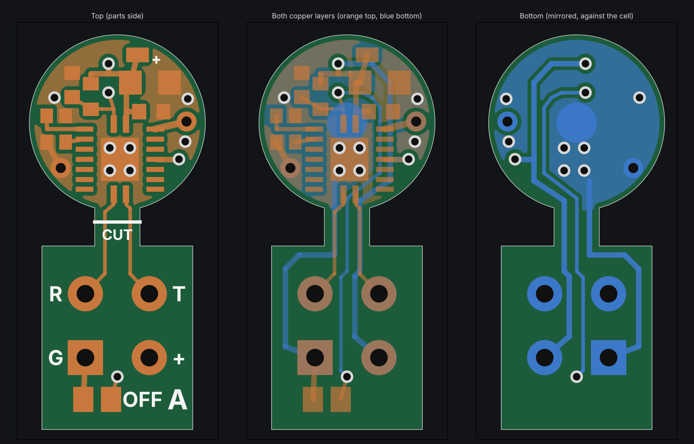
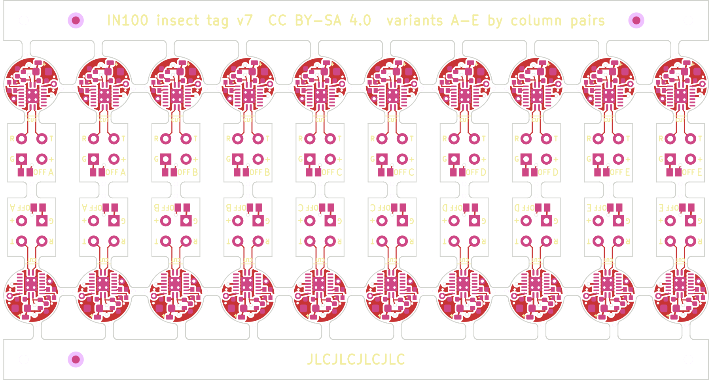

# IN100 insect tag v6 (7 mm round, cut-to-start tail)

This is an open Bluetooth LE beacon tag for insects, built around the InPlay **IN100 NanoBeacon**.
You choose **Hubble** or Apple **Find My** (OpenHaystack-style keys) when you burn the IN100's OTP.
JLCPCB fits all five parts from its own stock, all on the top side. You add the 337 cell underneath, a 30 mm wire and epoxy.

The tag works like a Blu Bat tag. It ships with a tail that carries the programming pads and an **OFF** jumper.
Once you've bridged the jumper and fitted the cell, the tag sits switched off.
**Cutting the tail starts it**, and it runs until the cell is flat.

## What changed from v5

| | v6 (this) | v5 |
|---|---|---|
| Tag | **7.0 mm round**, about 3.2 mm tall with the cell | 8.0 mm round, about 3.6 mm tall |
| Layout | IN100 near the tail and the small parts above it | IN100 in the centre |
| Bulk capacitor | **47 µF 0603** (C140782), sized for the first half of the cell at 0 dBm | 100 µF 0805, sized for the whole cell at +5 dBm |
| Switching on | **Cut the tail.** A solder-bridged OFF jumper on the tail holds CHIP_EN low until then | The tag runs as soon as the cell touches it |
| CHIP_EN | 1 MΩ pull-up and a 10 nF delay capacitor, so EN rises after VCC as the datasheet requires | Tied to VCC, which breaks the datasheet's power-up order |
| Cell + | A plated hole just outside the cell's edge for the + wire | A rim pad |
| Parts JLC fits | 5 (IN100, crystal, 47 µF, 1 MΩ, 10 nF) | 4 |
| Panel | 20 tags, 88 × 49 mm | 20 tags, 98 × 47 mm |

## Switching the tag on: the cut-to-start tail

The IN100 has an enable pin, **CHIP_EN**. With CHIP_EN at 0 V the chip draws about **10 nA**, which is effectively off. It starts when CHIP_EN goes high.

- **R1 (1 MΩ)** on the tag pulls CHIP_EN up to the cell.
- **JP1 "OFF"** is a solder jumper on the tail. Bridged with a blob of solder, it ties CHIP_EN to ground and holds the tag off.
- **C2 (10 nF)** also sits on the tail. With R1 it delays CHIP_EN by about 10 ms after power-up while you program the tag.
  The datasheet (Figure 18) wants CHIP_EN to rise only after VCC has reached 90 %.
- **Cutting the neck** separates the tail, and with it the jumper's short to ground. R1 pulls CHIP_EN up and the tag boots from its OTP and starts advertising.
  Because the cell is already steady when you cut, the power-up order is right by design.

The neck carries RXD and TXD on top, and GND, CHIP_EN and VCC underneath, with CHIP_EN between GND and VCC.
A copper burr from cutting can only short CHIP_EN to one of its neighbours:
- to VCC, which is harmless because the tag is meant to be running;
- to GND, which holds the tag off, and a quick scrape of the cut edge fixes it.

**Storage cost of the OFF jumper:** while it's bridged, R1 carries 1.55 V / 1 MΩ = **1.6 µA**. That is about **1.1 mAh, or 14 % of the cell, per month**.
For storage of a week or two that's fine. If tags will sit for months, fit the cell later.
Alternatively, change R1 to **10 MΩ** (C102764 or Yageo C138067, both JLC extended parts), which cuts the drain tenfold.
Test that value on one tag first: CHIP_EN's input leakage isn't in the datasheet.

If you never bridge the jumper, the tag simply starts when the cell goes on, as on v5.

## Capacitor and battery life

A 337 (SR416SW) is a low-drain silver-oxide cell with an internal resistance of about **80 Ω** (Energizer: 75–85 Ω at 40 Hz).
Its resistance rises in the cold and as the cell runs down.
The IN100 draws **9.1 mA** while transmitting at 0 dBm and **13.8 mA** at +5 dBm, and needs at least **1.1 V**.
A capacitor carries each advertising burst. `tools/burst_sim.py` models one event (crystal start-up, then three channels) and reports the lowest supply voltage; the full output is in `docs/burst_sim.txt`.

| Bulk capacitance (effective) | Fresh cell (80 Ω) | Cold or half used (150 Ω) | Nearly flat (250 Ω) |
|---|---|---|---|
| **47 µF 0603 (v6), 0 dBm** | **1.25 V** | **1.18 V** | 1.12 V (marginal) |
| 47 µF 0603 (v6), +5 dBm | 1.11 V (marginal) | 1.02 V ✗ | 0.95 V ✗ |
| 100 µF 0805 (v5), 0 dBm | 1.38 V | 1.35 V | 1.31 V |
| 10 µF (v4), 0 dBm | 0.92 V ✗ | 0.56 V ✗ | 0.25 V ✗ |

You said a few weeks and half the cell is enough, so v6 uses the **47 µF 0603** (Murata GRM188R60J476ME15D, 1.6 × 0.8 × 0.8 mm, JLC extended, large stock).
It holds the IN100 above 1.1 V at **0 dBm** through the first half of the cell and well beyond.
**Program 0 dBm or lower, and keep the 1 Mbps PHY.** +5 dBm, or the 125 kbps coded PHY with its 8× longer packets, needs v5's 100 µF.

Battery life at 0 dBm, assuming about 16 µC per advertising event and 0.625 µA of sleep current. These are upper bounds that ignore self-discharge:

| Advertising interval | 1 s | 2 s | **3 s** | 5 s | 10 s |
|---|---|---|---|---|---|
| Average current | 17 µA | 8.7 µA | **6.0 µA** | 3.9 µA | 2.2 µA |
| First half of the cell | 10 days | 20 days | **29 days** | 45 days | 77 days |
| Whole cell | 21 days | 40 days | **57 days** | 89 days | 5 months |

At a **3 s interval** the first half of the cell lasts about **4 weeks**. Continuous 1 s advertising gives about 10 days on the first half and 3 weeks in total.

## Circuit

- **U1 IN100 (QFN18, C6062024)** runs straight off the cell (1.1–3.6 V).
  - VCC and VDDQ go to the cell. CHIP_EN goes to R1, and to C2 and JP1 on the tail.
  - The UART is on GPIO0 (RXD) and GPIO1 (TXD).
  - The other GPIOs, the two load switches and the RTC crystal pins are left open; the internal 32 kHz RC oscillator is used.
- **Y1** TXC 8Q26000008: 26 MHz, 7 pF, ±16 ppm, 1.6 × 1.2 mm (C5203638). The IN100's on-chip load capacitors replace external ones.
- **C1** 47 µF 6.3 V X5R 0603 (C140782) sits at the VCC pin and is the only capacitor on the tag.
- **R1** 1 MΩ 0402 (C26083) pulls up CHIP_EN.
- **C2** 10 nF 0402 (C15195) and **JP1** "OFF" are on the tail and leave with it.
- **AE1** is a plated hole (0.4 mm drill) for about 30 mm of fine enamelled wire, a quarter wave at 2.44 GHz. It's fed straight from RF_TX.
- **BT1** has two connections:
  - **−:** a bare gold **Ø2 mm pad on the underside**, centred on the cell's negative cap, for a dot of silver epoxy.
  - **+:** a **plated hole at the top edge**, just outside the cell's outline, for the + wire.
- **J1** on the tail: **R** = RXD (into the IN100), **T** = TXD (out of the IN100), **G** = GND, **+** = VCC, on a 2 × 2, 2.54 mm grid.

Every part is on the top. The bottom is a ground plane with the CHIP_EN and VCC traces, and it sits against the cell.
Apart from the central epoxy pad, **keep Kapton between the board and the cell**: the cell's can is +, and the ground plane under the solder mask is −.

## What's in the folder

| Path | What it is |
|---|---|
| `insect_tag.kicad_pro`, `.kicad_sch`, `.kicad_pcb` | KiCad project (KiCad 7 format; checked in KiCad 10.0.7) |
| `insect_tag.kicad_sym`, `insect_tag.pretty/`, `insect_tag.3dshapes/` | IN100 QFN18 symbol, footprints and 3D models |
| `fab/jlcpcb_panel/` | **What you upload to JLCPCB**: Gerbers zip, BOM and CPL |
| `fab/jlcpcb_single/` | Gerbers for one tag + tail (bare boards for hand assembly) |
| `docs/` | Schematic PDF, board preview, KiCad 3D render, panel render, DRC report, burst simulation output |
| `tools/` | Generators (`design.py` holds every part, placement and track), `burst_sim.py`, KiKit panel config, `make_fab.sh` |

## Ordering from JLCPCB

1. Upload `fab/jlcpcb_panel/insect_tag_panel_gerbers.zip`. Options:
   - 2 layers, **0.6 mm** thickness, ENIG (the QFN has a 0.4 mm pitch, and the epoxy pad should be gold).
   - Delivery format **Panel by Customer**. The rails, tooling holes and fiducials are in the Gerbers.
   - For "Mark on PCB", specify the location: the bottom rail carries a `JLCJLCJLCJLC` marker.
2. Turn on PCB Assembly, top side. Upload `insect_tag_panel_bom.csv` and `insect_tag_panel_pos.csv`.
   - Every placement has its own designator (U1_1 … U1_20), so JLC counts 20 of each part per panel.
   - U1 (C6062024), Y1 (C5203638) and C1 (C140782) are **extended** parts. R1 and C2 are basic.
   - JP1 is bare copper with no part; you bridge it yourself.
3. In the placement preview, check that the pin-1 marks on **U1** and **Y1** match the silkscreen dots.

## Bringing up a tag

1. **Break a tag out of the panel.** Snap the tabs and sand the nubs. **Leave the tail on.**
2. **Program it, with no cell fitted and JP1 open.** Wire a 3.3 V USB-UART adapter to the tail's pads, using a pogo jig, a 2 × 2 header or tacked wires:
   - **T** → adapter RX
   - **R** → adapter TX
   - **G** → GND
   - **+** → 3.3 V

   Use 3.3 V because VDDQ needs it (up to 50 mA) while the OTP is burned.
   Program with InPlay's NanoBeacon Config Tool:
   - Load the configuration into RAM first and check it with a phone scanner, then burn the OTP. **The OTP can be written only once.**
   - Set TX power to **0 dBm or lower**, keep the **1 Mbps** PHY, and set the interval (3 s gives about 4 weeks on half the cell).
   - *Hubble:* follow Hubble's IN100 guide.
   - *Find My (OpenHaystack-style):* non-connectable advertising with the payload `1E FF 4C 00 12 19 00 <key bytes 6–27> <key[0] >> 6> 00`.
     The static random address is `key[0] | 0xC0, key[1..5]`.

   After the burn, power-cycle the adapter and check that the tag advertises from OTP.
3. **Bridge JP1 "OFF"** with a blob of solder. Power the tail from the adapter again: the tag must now stay silent. Disconnect the adapter.
   **Never connect the programmer again once the cell is fitted**: its 3.3 V would be driven into the cell.
4. **Antenna:** strip about 0.5 mm of a ~0.1 mm enamelled copper wire. Push it through the hole by RF_TX, solder it, and trim the wire to 30 mm.
   Trimming shortens it and raises its resonant frequency. Epoxy lowers it.
5. **Fit the cell with silver epoxy** (no soldering on the cell). The cell's small raised cap (−) faces the board and the can (+) faces away.
   - Punch a **Kapton washer** with a ~2 mm hole and stick it on the underside, the hole over the gold pad. The bottom silkscreen ring shows where the cell sits.
   - Put a **small** dot of two-part silver epoxy on the gold pad and press the cell on, centred in the ring.
     **The cap and the can are only a fraction of a millimetre apart. Epoxy that bridges them shorts the cell.**
   - **+:** solder a short piece of thin wire into the **+** plated hole at the top edge. Bend it down and tack it to the can's side wall with silver epoxy.
   - Hold the stack together while the epoxy cures at room temperature. Don't heat the cell above its 60 °C rating.
     Then add a structural-epoxy fillet around the cell's edge.
6. **Check the cell:** with a meter on the tail's **+** and **G** pads you should read about 1.55 V. The tag should still be silent on a scanner.
7. **Coat** the tag and cell in a thin layer of structural epoxy, up to the neck. Leave the antenna wire free beyond the first millimetre.
8. **In the field:** cut the neck at the silkscreen **CUT** line with sharp flush cutters. The tag starts within a second.
   Check it on a phone scanner, then seal the cut edge with a dot of epoxy or nail varnish before attaching the tag.

## Mass and size (estimate)

| Part | Mass |
|---|---|
| Board, 7 mm × 0.6 mm FR-4 | 43 mg |
| Copper, mask and finish | ~22 mg |
| IN100, crystal, 1 MΩ, solder | ~26 mg |
| 47 µF 0603 capacitor | ~6 mg |
| Antenna wire (30 mm, 0.1 mm) | ~2 mg |
| 337 cell | 130 mg |
| **Total before epoxy** | **≈ 0.23 g** |

Height: cell 1.65 mm + Kapton and epoxy dot about 0.1 mm + board 0.6 mm + capacitor 0.8 mm (the tallest part) ≈ **3.2 mm** before the epoxy coat.
The neck stub after cutting is about 0.5 mm. Weigh your first tags rather than relying on these numbers.

## Checks done

- **KiCad 7.0 DRC** (the build tools): 0 violations, 0 unconnected; the board netlist matches the design.
- **KiCad 10.0.7 DRC** (after a zone refill): 0 errors, 0 warnings, 0 schematic-parity issues.
  **KiCad 10.0.7 ERC**: 0 errors, plus 3 cosmetic warnings saying the embedded jumper, crystal and battery symbols differ from KiCad 10's library copies (`docs/kicad10_checks.txt`).
- JLC standard rules throughout: tracks and gaps ≥ 0.13 mm, 0.3 mm vias, copper ≥ 0.2 mm from the edge.
  The only finer feature is the QFN's own 0.4 mm pin pitch.

## Before you order a batch

- **QFN18 land pattern:** built from InPlay's package drawing (datasheet v1.3). Compare it with the LCSC/JLC footprint preview before ordering.
- **Crystal land pattern:** the 1612 pads come from the NDK NX1612SA layout. Check them against TXC's 8Q drawing.
- **CHIP_EN through 1 MΩ** is weaker than the reference designs, which use 10 kΩ or a direct tie. Confirm on your first tag that it starts reliably every time you cut the tail.
- **Sleep current:** large ceramic capacitors are only loosely specified for leakage. Measure one finished tag's average current.
  If it's well above about 1 µA between advertisements, the capacitor is the cause.
- **RF and battery life** are estimates; nothing here has been tested on air yet. **Order one panel and bring up one tag end to end before you order more.**

## Rebuilding

- `tools/design.py` holds the parts, nets, outline, placement and every track and via.
- `tools/gen_footprints.py` writes the footprints and 3D models.
- `tools/build.py` writes the KiCad files, `tools/check.py` runs DRC and a netlist check, and `tools/render.py` draws the previews.
- `tools/make_fab.sh` rebuilds the panel and JLC files and needs [KiKit](https://github.com/yaqwsx/KiKit) (run it with the Python that has KiCad's `pcbnew` and `wx`).

## License

CC BY-SA 4.0. The IN100 circuit references were InPlay's IN100 datasheet and SparkFun's NanoBeacon boards (CC BY-SA 4.0).
No warranty: you build and use these at your own risk.
