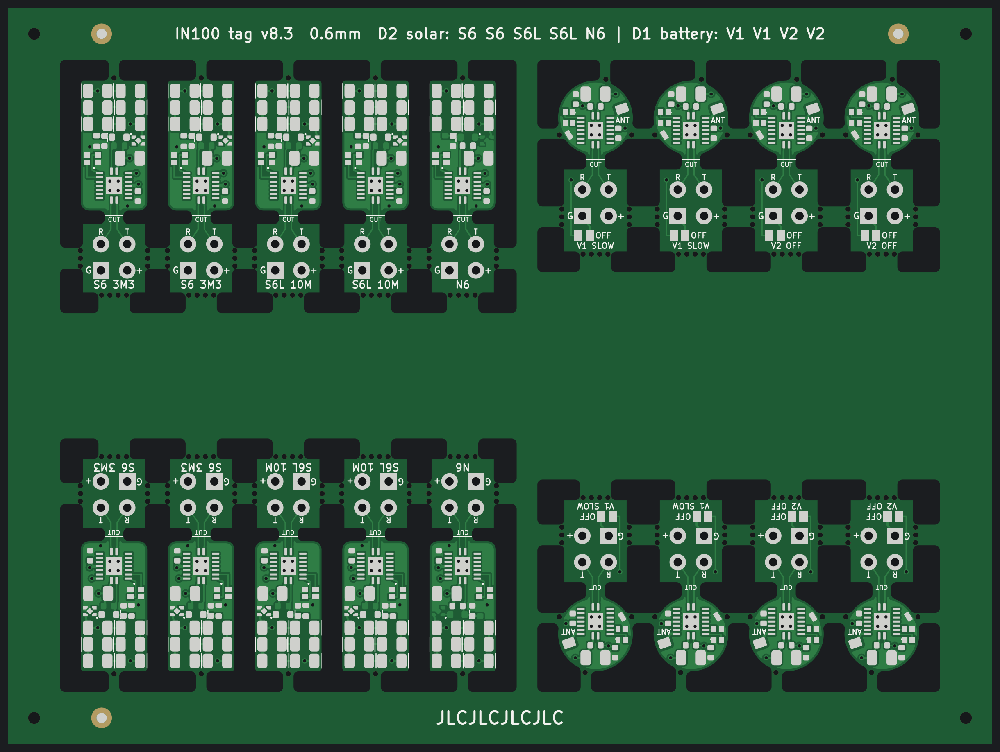

# IN100 insect tag v8.3: combined 0.6 mm test panel (D2 solar + D1 battery)

One JLCPCB order that carries both tags on one 0.6 mm panel. The panel holds every variant needed to settle the
open questions on the bench. Assembling the minimum of **2 panels gives 36 working tags**: 20 solar and 16 battery.
The other 3 panels of the PCB order come back bare.

| | Per panel | **2 assembled panels** | What it tests |
|---|---|---|---|
| **D2 S6** (start circuit, R2 3.3 MΩ) | 4 | **8** | The safe solar build, if the IN100 sends its first advert straight after start |
| **D2 S6L** (start circuit, R2 10 MΩ) | 4 | **8** | The fallback if the first advert comes one interval late |
| **D2 N6** (no start circuit, R1 1 MΩ) | 2 | **4** | Your minimal circuit. It is expected to lock in anything dimmer than ≈ 5 klx |
| **D1 V1** (1 MΩ / 100 nF, slow enable) | 4 | **8** | The "just works" battery build: fit the cell live |
| **D1 V2** (100 kΩ / 10 nF + OFF jumper) | 4 | **8** | Cut-to-start, and the hedge against an unpublished CHIP_EN load (below) |

Panel: **94.9 × 71.1 mm**, 2 layers, 0.6 mm. A 5 mm frame carries 4 tooling holes (1.152 mm) and 3 fiducials, and a
12 mm backbone runs across the middle. Two designs share the panel.
- Each tag's **tail** is held on three sides by wide tabs (3 mm and 2 × 2 mm), so the panel stays stiff through
  printing and reflow. Those nubs end up on the tails, which you cut off anyway.
- **Bodies:**
  - D2 bodies hang from one 1 mm tab at the far end plus the neck. Their long edges carry parts 0.2 mm from the edge,
    so they get no side tabs.
  - D1 discs also have two 1 mm side tabs.
- Every tag carries its variant on the **underside** (S6 / S6L / N6 / V1 / V2), so you can still tell them apart after
  the tail is cut.

## Why these numbers

- **Why 2 panels.** BOM is about 75 % of the cost (≈ €6 per solar tag, ≈ €2.30 per battery tag). Two panels is JLC's
  minimum assembly quantity, and it still gives 8 of each main variant.
- **Why 8 per variant is enough.**
  - S6 and S6L have identical copper: either becomes the other by swapping one 0402 resistor (R2). So whichever start
    circuit wins, all 16 S tags can run it.
  - V1 and V2 also share copper (R1 and C2), so all 16 battery tags can follow the winner.
- **N6 is the experiment.** The simulation predicts it locks, so 4 tags are enough to see it.
- **The 3 bare panels** give 54 spare bare boards for hand-built variants.
- **Unfitted parts are covered by solder mask and get no paste.** Their pads are neither printed nor tinned, so they
  can't bridge to a fitted neighbour. This matters for D2: on S6/S6L tags, R1's empty pads sit 0.155 mm from D2 and
  0.19 mm from C1, where a bridge would short RST or CHIP_EN to VCC.

### What could make a whole design fail, and what covers it

| Unknown (not in the IN100 datasheet) | Affects | Covered by |
|---|---|---|
| Delay from CHIP_EN high to the first advert | S6 in dim light | S6L (and the advertising interval, an OTP setting) |
| CHIP_EN turn-off level | S6L in dim light | S6 |
| **CHIP_EN input current or internal pull-down** | Every 1 MΩ enable: D1 V1 and D2 N6 | **D1 V2 now uses 100 kΩ.** It works with a pull-down down to 150 kΩ or up to ≈ 5 µA of input current; 1 MΩ needs ≥ 1.5 MΩ or ≤ 0.5 µA. D2 S6/S6L are unaffected, because U2 drives CHIP_EN actively |
| CHIP_EN briefly above a sagging VCC (absolute maximum is VCC) | D1 V1 (τ 0.1 s) | D1 V2 (τ 1 ms) |
| C1's real capacitance at 1.5 V (≈ 55 µF assumed, 45 µF worst) | Burst margin on both tags | Program 0 dBm on 337 cells, and measure the dip in bring-up |

**The cost of the V2 hedge:** with OFF bridged, V2 draws 15.5 µA, so a 337 lasts ≈ 22 days bridged (V1: 1.6 µA,
≈ 7 months). On V2, fit the cell close to when you cut the tail. If V1 works, you can swap V2's R1/C2 to 1 MΩ/100 nF.

## What changed in v8.3 (from v8.2)

| | v8.2 | **v8.3** |
|---|---|---|
| Board | 0.8 mm, two separate panels, Economic PCBA | **0.6 mm, one combined panel, Standard PCBA** (Economic only takes 0.8–1.6 mm) |
| D2 antenna pads | Top side; AE1 0.17 mm from C1's GND pad, AE2 0.43 mm from IN100 pins | **Underside**, where there are no parts: 1.2 × 1.0 mm, nothing but solder-masked pour within 0.25 mm. RF_TX reaches AE1 through one via inside the pad |
| D1 antenna pads | AE1 0.29 mm from C4; AE2 0.20 mm from a crystal pad | **AE1 moved to the upper-right rim** and enlarged to 1.2 × 0.9 mm, ≥ 0.75 mm from every other-net pad. **AE2** is now a slim pad hugging the rim, 0.36 mm clear (this is the only GND-safe spot on that side) |
| D1 V2 | 1 MΩ / 1 nF | **100 kΩ / 10 nF** (hedge, see above) |
| Panel | 82 × 57 mm, below Standard PCBA's 70 × 70 mm minimum | **94.9 × 71.1 mm**, full frame, backbone, wide tail tabs, D1 side tabs aligned (v8.2's met through a 0.4 mm Z-neck) |
| Unfitted parts | Pasted and tinned like the rest | **Masked over, no paste** |
| IN100 exposed-pad paste | Four windows sitting right over the four thermal vias, so the barrels could swallow the paste and starve the IN100's only GND connection | **A cross through the centre, ≥ 0.13 mm from every via drill** |
| TPS3831 (X2SON) paste | 1 : 1 with pads 0.14 mm from the thermal pad | **0.04 mm smaller all round**, close to TI's stencil example |
| Copper crossing CUT | VCC and GND 0.15 mm apart on the underside | **D2 0.40 mm, D1 0.29–0.31 mm** |
| D2 body side tabs | Beside C1 (0805, across the break line) and U2 | **Removed** |
| Variant after cutting | Only on the tail | **Also on the underside of the body** |

The battery-cell pads are unchanged; there is ≥ 2.3 mm free round the + pad.
- **− pad:** Ø 2.0 mm, centred under the IN100.
- **+ pad:** 0.9 × 1.2 mm on the rim.

## Ordering from JLCPCB

Upload everything from `fab/jlcpcb_panel/`.

**1. PCB.** Upload `insect_tag_v8_combined_panel_gerbers.zip`.

| Setting | Value |
|---|---|
| Layers / material | 2, FR-4 |
| Different Design in Panel | **2** (D1 and D2; JLC adds a small fee) |
| Delivery format | **Panel by Customer** (frame, tooling holes and fiducials are in the Gerbers) |
| PCB qty | 5 panels (the minimum) |
| **Thickness** | **0.6 mm** |
| Surface finish | **ENIG recommended**: flat pads for the 0.4 mm-pitch QFN and the 1 × 1 mm X2SON, and no hot-solder dip on a thin panel. LeadFree HASL is allowed at 0.6 mm and also works |
| Mark on PCB | Specify a location: the `JLCJLCJLCJLC` text on the bottom rail |
| Via covering | Tented |
| Everything else | Default (green, white silk, 1 oz) |

**2. PCB Assembly.**

| Setting | Value |
|---|---|
| Type | **Standard** |
| Side | Top |
| **PCBA qty** | **2** panels |
| Tooling holes | Added by customer |
| Confirm parts placement | Yes |
| Depanel | No: break the tags out yourself |

Then upload `insect_tag_v8_combined_panel_bom.csv` and `insect_tag_v8_combined_panel_pos.csv`. Each placement has its
own designator: `R2_S6L_3` is R2 on the third S6L tag. `docs/panel_units.csv` maps every unit to its column and row.

**3. Parts.** Stock is from JLC's parts database on 6 Nov 2026; **check it again in the cart**. LCSC's own
shop showed C1 out of stock, but JLC's assembly library has its own stock.

| Part | LCSC | Fitted on 2 panels | Stock | Type |
|---|---|---|---|---|
| IN100-Q1-R-RC1I | C6062024 | 36 | 703 | Extended |
| Crystal 26 MHz 1612 (TXC 8Q26000008) | C5203638 | 36 | 1,313 | Extended |
| 100 µF 6.3 V X5R 0805 (Murata) | C141660 | 36 | 143,099 | Extended. If the cart says short: Taiyo Yuden JMK212BBJ107MG-TE **C2880375** (5,627; has published DC-bias data) or CCTC C49215609 (9,895) |
| TEMD7000X01 | C145328 | 120 | 2,315 | Extended |
| TPS3831G18DQNR | C2066667 | 16 | **57** (DQNT reel: C2871539, 50) | Extended |
| RB751S40T1G | C232576 | 16 | 43,919 | Extended |
| 330 nF 0402 | C107013 | 20 | 174,216 | Extended |
| 3.3 MΩ 0402 | C270613 | 8 | 93,150 | Extended |
| 10 MΩ 0402 | C26082 | 8 | 11,966 | Preferred |
| 1 MΩ, 100 kΩ, 100 nF, 10 nF (0402) | C26083, C25741, C1525, C15195 | 12, 8, 44, 8 | Millions | Basic |

InPlay's June 2026 datasheet (V2.4) drops IN100-Q1-R-RC1I from its ordering table, so stock may not come back.

**4. Placement preview: check every one of these.** The bottom row is turned 180°, so its marks are too.
- **U1 (IN100):** the pin-1 dot sits next to the crystal (upper left on an upright tag). A 90° error is fatal.
- **Y1 (crystal):** pads 1/3 (XO) on one diagonal, 2/4 (GND) on the other. **A 90° error puts the crystal on GND**;
  180° is harmless.
- **U2 (TPS3831, S tags only):** pin-1 dot at the upper left.
- **D2 (RB751, S tags only):** cathode bar towards C5. Reversed, the S tags never start.
- **Photodiodes:** pad 1 = cathode, marked by the silk bar. The middle row of each 2 × 3 block is turned 180°.

Fix any offset in JLC's preview, not in the files.

**Rough cost** for 5 PCBs plus 2 assembled panels:

| Item | Estimate |
|---|---|
| Parts | ≈ €150 |
| Setup, stencil, extended-part fees, fixture | ≈ €75 |
| PCB, including the two-design fee and ENIG | ≈ €20–50 |
| **Total** | **≈ €250–280 before shipping and VAT**, about €7 per assembled tag |

The cart is the real number. Choosing PCBA qty 5 instead of 2 gives 90 tags at roughly three quarters of the per-tag cost.

## Finishing the tags

**Bring-up order**
1. Program each tag while it is still on the panel (pogo jig on the tail pads).
2. Power it through J1 and check it advertises.
3. Only then break it out. This catches any assembly fault before you put work into it.

**Breaking out**
- **Don't snap the bodies out.** Cut each 1 mm body tab with a flush cutter or scalpel from the panel side, supporting
  the tag, then sand the nub. C1 (0805) and the 1 × 1 mm U2 sit close to the edges.
- The tail tabs are wide; snap or cut those however you like.
- **Cutting the tail:** score the **CUT** line on both faces with a scalpel and snap it, or file through it. Don't use
  side cutters, which can smear copper across VCC and GND. This matters most on D1 V2, which you cut with the cell
  live. Then:
  - check VCC–GND across C1;
  - seal the cut edge.

The full steps are in each tag's README:
- `../hagalu/README.md` (D2)
- `../irulu/README.md` (D1)

In short:
1. Break a tag out with its tail. Program it through the tail pads, then fit the antenna:
   - **D2:** both wires on the **underside** pads, labelled **ANT** (right edge) and **GND** (left edge).
   - **D1:** the **ANT** pad on the upper-right rim, and optionally a GND wire on the slim pad at the lower left,
     between the crystal and the IN100.
2. D1 only: fit the cell.
3. Cut the tail at **CUT**.

## Checks done

- **Both tags, KiCad 7:**
  - DRC 0 violations, 0 unconnected; netlist matches `design.py`; no pour islands.
  - Silk text ≥ 0.12 mm from every pad except the tail labels.
- **Panel, KiCad 7:** DRC 0 violations, 0 unconnected (`docs/insect_tag_v8_combined_panel_drc.txt`).
- **KiCad 10.0.7 on the Mac:** panel and both tags DRC 0 errors, 0 unconnected; only cosmetic warnings (mirrored
  B.Fab reference text). ERC 0 errors on both schematics.
- **Panel structure:**
  - One connected outline; every tab ends in solid substrate (the bar, the backbone or the frame).
  - Bottom paste layer empty.
- **BOM/CPL:** 18 units and 184 placements per panel. Every unit carries every part of its design exactly once (the
  script checks this), and each part count matches the variants.
- **JLC rules:**
  - Tracks and gaps ≥ 0.127 mm; vias 0.3/0.5 mm; copper ≥ 0.2 mm from edges and holes.
  - Board gaps ≥ 2 mm; mouse bites 0.5 mm at 0.75 mm.
  - 5 mm frame with fiducials and tooling holes; panel above Standard PCBA's 70 × 70 mm minimum.
- **JLC's review may ask about:**
  - copper exactly 0.20 mm from the board edge and from mouse-bite holes (their minimum);
  - the drill file mixing plated and unplated holes: the 0.5 mm mouse bites and 1.152 mm tooling holes are unplated.
- **Two known deviations from JLC's recommendations, both deliberate:**
  - **Silk text** is 0.4–0.7 mm tall where the tags have no room (JLC recommends ≥ 1 mm), so it may print fuzzy.
  - **The tabs on the tag bodies** are 1 mm wide (JLC recommends ≥ 5 mm), so the tiny tags break out cleanly. The
    panel's stiffness comes from the wide tail tabs and the backbone.
- **Independent review** (a separate agent, from datasheets and the fab files): no blocker. Its fixes are applied, as
  in the table above. Full report: `docs/independent_review_v8.3.md`.

## Rebuilding

1. Rebuild both tags: `insect_tag_v8_*/tools/run_all.sh`.
2. In this folder, run `KIKIT="python3.12 -m kikit.ui" PY=python3.12 bash tools/make_fab.sh`. It:
   - places the boards, backbone, bar and teeth (`tools/mixed_layout.py`, a KiKit layout plugin, configured by
     `tools/mixed_panel.json`);
   - runs KiKit's tabs, frame, tooling, fiducials and text (`tools/panel.json`);
   - sets each unit's population and writes the BOM and CPL (`tools/mixed_variants.py`);
   - writes the Gerbers.

Copyleft, with credit to the author required: CERN-OHL-S-2.0 for the hardware, CC BY-SA 4.0 for the documentation, AGPL-3.0-or-later for the scripts. See [the licence section](../README.md#licence) and [`NOTICE`](../NOTICE). No warranty: you build and use these at your own risk.
